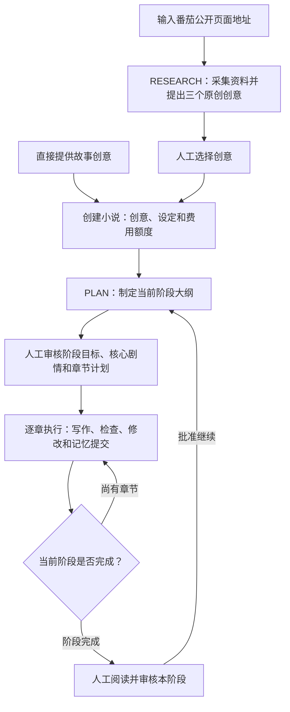
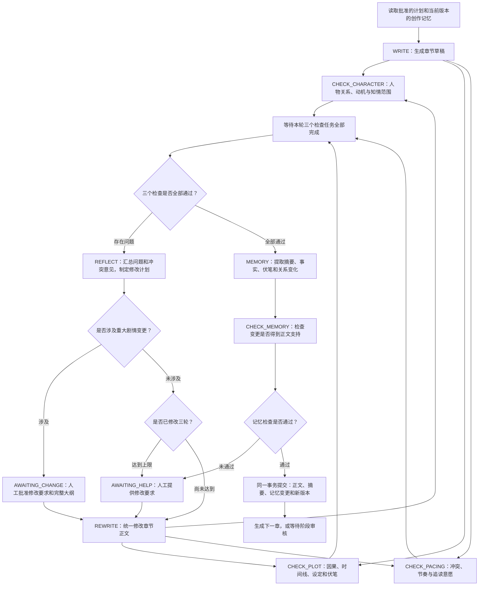
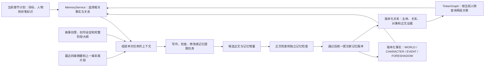
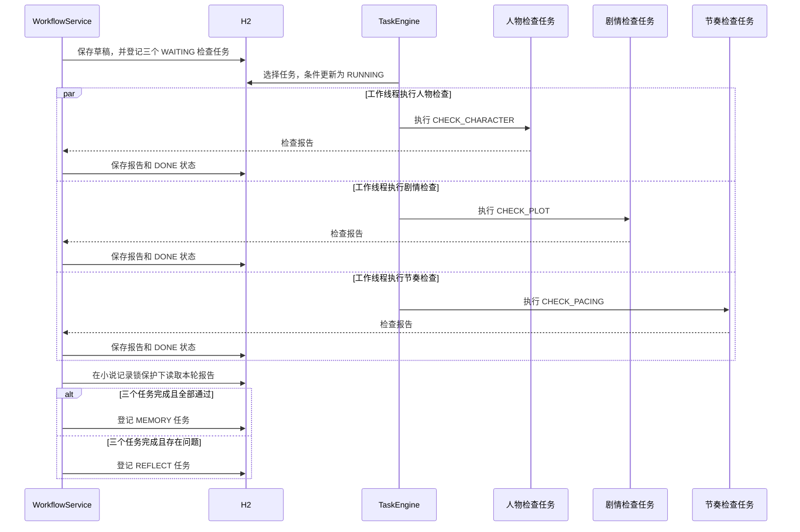
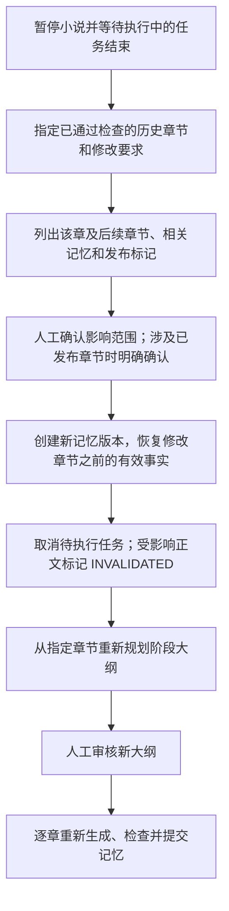

# Novel Agent

面向中文网文持续连载的个人创作工作台，使用 Java 17、Spring Boot、H2 和 Apache TinkerGraph。通过阶段规划、逐章写作、并行检查和修改流程维护剧情，人工负责选题、阶段审核及重要剧情变更。

## 创作工作流

一部小说由连续的故事阶段组成，每个阶段默认10章，创建作品时可以设置为1至20章。阶段审核通过后继续规划下一阶段，整部小说不预设完结章数。人工审核、费用额度及电脑运行状态决定任务何时继续。



选题调研接受1至5个番茄公开页面地址，保存 URL、标题、采集时间和文字摘录，再生成创意。资料由用户提供地址，网页读取使用 Jsoup。作品也可以直接从人工提供的创意开始创建。

阶段大纲包含 `stageGoal`、`coreMilestones`，以及每章的编号、标题、目标、出场人物和关联伏笔。人工可以修改完整大纲，批准后开始正文生成。

## 每章的 Plan–Execute–Check–Reflect 流程

Plan 对应已批准的阶段及章节计划。Execute 生成正文，Check 独立检查正文，Reflect 仅在检查发现问题时执行。正文通过后还有一次独立的记忆检查。



| 任务 | 负责内容 | 输出 |
| --- | --- | --- |
| `RESEARCH` | 依据资料提出原创选题 | 三个创意及来源 |
| `PLAN` | 阶段冲突、剧情节点和章节安排 | 阶段大纲 |
| `WRITE` / `REWRITE` | 生成或统一修改章节 | 标题、正文 |
| `CHECK_CHARACTER` | 人物关系、动机、性格与知情范围 | 结论、正文证据和修改建议 |
| `CHECK_PLOT` | 因果、时间线、世界规则、伏笔与大纲执行 | 结论、正文证据和修改建议 |
| `CHECK_PACING` | 冲突推进、失败代价、信息揭示、高潮与缓和 | 结论、正文证据和修改建议 |
| `REFLECT` | 汇总检查意见，处理相互冲突的建议 | 统一修改计划、重大变更标记 |
| `MEMORY` | 提取本章记忆增量 | 摘要、事实与关系变更 |
| `CHECK_MEMORY` | 核对记忆变更与正文、历史设定 | 检查结论及问题证据 |

每个角色由独立任务、提示词及结构化输入输出定义，任务在同一 Java 应用中执行。检查角色提交报告，正文由写作角色统一修改，记忆由流程模块统一提交。

检查报告需要引用当前正文中至少4个字符的原文。程序校验证据是否存在、结论与问题列表是否一致；模型负责评价语义和阅读节奏。正文目标长度为2000至3000字，程序允许1800至3800个字符。

自动修改最多三轮，且始终受费用额度限制。修改涉及核心剧情、人物重要转变、关键伏笔答案或阶段结局时等待人工批准。人工批准后可以明确发起新的修改轮次。记忆检查失败也进入人工处理，批准修改后重新执行正文检查及记忆提取。

## 持续连载的上下文与记忆

完整正文和历史资料长期保存在数据库，每次模型调用按当前章节组装上下文。阶段规划和章节创作使用不同的资料范围。



### 记忆保存

| 数据 | 保存方式 | 用途 |
| --- | --- | --- |
| 当前正文 | `chapters` | 阅读、检查和导出 |
| 正文修改历史 | `chapter_history` | 保留被替换的正文版本 |
| 世界规则、人物、事件、伏笔 | `memories` 中的版本化事实 | 规划与生成时查询 |
| 人物关系与知情范围 | `memories` 中的 `RELATION` 记录 | 构建指定版本的 graph |
| 阶段大纲 | `novels.plan` | 控制当前阶段剧情 |
| 任务和调用记录 | `tasks`、`model_calls`、`events` | 恢复执行、核对费用和追踪问题 |

事实沿用稳定的 `key`；关系使用 `subject`、`predicate`、`object` 标识，并保存来源章节和原文证据。例如，人物掌握某个秘密使用 `KNOWS` 关系，秘密作为对象。结束的关系通过 `deleted=true` 标记；伏笔回收沿用原 `key` 并设置 `active=false`。

关系记录持久化在 H2，查询时使用指定记忆版本构建 TinkerGraph。网页支持一至三层关联查询，章节上下文默认查询两层关联。

### 本章上下文选择

- 根据出场人物、关联 graph 节点、明确指定的伏笔、预计回收章节和近期事件选择事实。
- 按评分提供最多50条事实，并记录未提供的匹配数量。
- 提供最近四章已通过检查的摘要，以及上一章最多4000个字符的末尾片段。
- 同时提供故事创意、创作设定、完整阶段大纲及本次读取的记忆版本。
- 系统提示和用户消息序列化后的 UTF-8 字节数默认上限为60000，超过上限时任务明确失败并等待处理。

阶段规划读取最近八章摘要，并分别选择最多15条世界规则、15条人物记忆、15条事件和30条仍然有效的伏笔。原始资料继续保留在数据库。

记忆提取每章最多产生40条事实与关系变更，每条变更需要正文证据。通过检查后，正文转为 `ACCEPTED`，摘要、记忆变更和 `memory_version` 在同一事务内提交。后续章节读取新版本；旧记忆版本下执行的任务不能提交为当前结果。

## 多任务并发与持久化编排

`TaskEngine` 每500毫秒检查可执行任务，默认使用4个工作线程。多部小说独立推进，同一部小说按章节依赖生成；某章生成完成后，三个正文检查任务可以并行执行。



实际并发数量取决于空闲工作线程和调用限额。选择任务时优先考虑当前执行任务较少的作品，再根据任务时间排序。

任务记录包含作品、任务类型、章节、修改轮次、记忆版本、输入、输出和错误。`task_key` 由作品、阶段、章节、修改轮次、记忆版本和任务类型组成，数据库唯一约束与应用检查共同防止重复登记同一步骤。

流程结果提交时锁定对应小说记录，串行判断本轮是否已经完成，再登记下一步任务。正文检查之间可以并行，影响同一小说进度的状态提交受数据库事务保护。

### 费用与速率限制

每次调用先检查上下文字节数，再在预算记录锁保护下检查速率和额度、预留费用，随后请求云端模型。

| 配置 | 默认值 | 范围 |
| --- | --- | --- |
| `novel.workers` | 4 | 全部作品共享的工作线程数量 |
| `novel.model.requests-per-minute` | 30 | 全部模型调用共享的滚动60秒限额 |
| `novel.monthly-budget` | 300元 | 按北京时间月份统计的总额度 |
| 作品月额度 | 100元 | 创建作品时设置 |
| 章节调用额度 | 5元 | 创建作品时设置，累计该章节全部任务费用 |

速率达到上限时，任务延后5秒重新等待调度。费用额度不足时，该作品进入 `BUDGET_PAUSED`，已有进度保留。供应商返回 token 用量后，按配置的人民币单价结算，并保存本次调用使用的模型和单价。

阶段规划任务也带有章节编号，其费用计入对应章节额度。输入费用预留依据消息字节数估算；实际费用超过预留金额时，任务停止并要求核查供应商单价及 token 规则。

### 暂停、失败与重启恢复

- **主动暂停**：停止继续推进该作品；已发出的调用仍可能完成和计费。结果保存为 `READY`，恢复后继续处理。
- **任务失败**：任务进入 `ERROR`，所属小说暂停；其他作品继续执行。人工可以明确重新执行失败任务。
- **重启恢复**：此前处于 `RUNNING` 且没有结果不确定调用的任务重新进入等待调度。已保存的任务结果或 `COMPLETE` 模型响应可以复用。
- **调用结果不确定**：此前处于 `IN_FLIGHT` 的调用转为 `UNCERTAIN`，保留费用预留。人工在供应商后台核对实际费用后，才能明确重新执行关联任务。

## 历史章节修改

当前影响分析保守包含修改章节及全部后续章节，同时列出来源章节位于该范围内的当前记忆。批准操作会使受影响正文等待重新生成。



历史记忆版本保留，正文被替换前保存到 `chapter_history`。修改请求记录创建时的记忆版本；批准时若版本已变化，需要重新分析影响范围。结果不确定的调用需要完成费用核对后才能批准历史修改。

## 启动与配置

运行环境需要 Java 17 或更高版本。项目自带 Maven Wrapper；当前 `start.ps1` 使用本机路径 `C:\Program Files\Java\jdk-17`，其他电脑需要调整脚本中的 `JAVA_HOME`。

在 PowerShell 中执行：

```powershell
Set-Location 'D:\java_learning\novel-agent'
Copy-Item -LiteralPath 'config\application-local.example.yml' -Destination 'config\application-local.yml'
```

编辑 `config/application-local.yml`，填写供应商实际配置：

| 字段 | 内容 |
| --- | --- |
| `novel.model.endpoint` | 完整的 HTTPS Chat Completions 地址 |
| `novel.model.api-key` | API key |
| `novel.model.name` | 模型名称 |
| `novel.model.input-per-million` | 每百万输入 token 的人民币价格，必须大于零 |
| `novel.model.output-per-million` | 每百万输出 token 的人民币价格，必须大于零 |

模型需要支持 `response_format: json_object`、`max_tokens`，并返回 `usage.prompt_tokens`、`usage.completion_tokens`。也可以使用 `NOVEL_MODEL_ENDPOINT`、`NOVEL_MODEL_API_KEY`、`NOVEL_MODEL_NAME`、`NOVEL_INPUT_PRICE`、`NOVEL_OUTPUT_PRICE` 环境变量。`novel.agents` 下可以按角色分别配置模型名称、地址、密钥及价格；未单独配置的字段使用 `novel.model` 中的值。

```powershell
.\start.ps1
```

脚本构建项目，将 JAR 复制到独立的运行目录，以 `local` profile 启动。访问 [本地创作工作台](http://127.0.0.1:8096)。服务默认仅监听本机地址。

网页操作顺序：选题研究或直接创建作品 → 阶段大纲审核 → 查看章节和执行记录 → 处理修改或费用待办 → 阶段阅读审核 → 继续下一阶段。正文可以导出为文本文件，发布及平台正文修改由人工完成。

数据库默认位于 `data/novel`。`data/`、`target/`、`.work/`、日志、`.env` 和 `config/application-local.yml` 已加入 Git 忽略规则。

## 代码入口

| 文件 | 职责 |
| --- | --- |
| [WorkflowService.java](src/main/java/dev/novel/WorkflowService.java) | 完成步骤、汇总检查、安排下一步及统一提交 |
| [TaskEngine.java](src/main/java/dev/novel/TaskEngine.java) | 调度、工作线程、失败处理和启动恢复 |
| [AgentService.java](src/main/java/dev/novel/AgentService.java) | 各角色提示词、任务执行和输出校验 |
| [MemoryService.java](src/main/java/dev/novel/MemoryService.java) | 版本化事实、graph 查询和上下文组装 |
| [ProjectService.java](src/main/java/dev/novel/ProjectService.java) | 人工审批、暂停恢复和历史修改 |
| [ModelClient.java](src/main/java/dev/novel/ModelClient.java) | 模型配置选择、响应复用、请求和结算 |
| [BudgetService.java](src/main/java/dev/novel/BudgetService.java) | 并发费用预留、速率检查及费用核对 |
| [schema.sql](src/main/resources/schema.sql) | 作品、任务、章节、记忆及调用记录表 |

## 验证范围

```powershell
$env:JAVA_HOME = 'C:\Program Files\Java\jdk-17'
.\mvnw.cmd -B -ntp package
```

已有15项自动验证通过，覆盖真实 H2 数据库、TinkerGraph 和本地 HTTP 接口，包括并发费用预留、速率限制、关系历史查询、证据校验、事务完整性、人工审核、历史修改、恢复及失败隔离。

`LiveModelTest` 默认不执行。配置真实模型环境变量，并设置 `NOVEL_LIVE_TEST=true` 后，可以运行真实模型验证；该测试会产生调用费用。

```powershell
$env:NOVEL_LIVE_TEST = 'true'
.\mvnw.cmd -B -ntp '-Dtest=LiveModelTest' test
```

真实模型验证覆盖大纲、正文和三个并行检查；正文检查通过时继续验证记忆提取与记忆检查。小说质量、长期连载中的检索准确率、动态榜单的可读取范围及实际收益需要结合真实运行评价。
