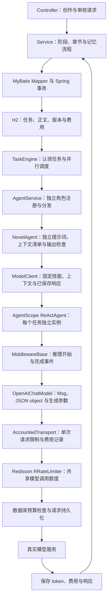
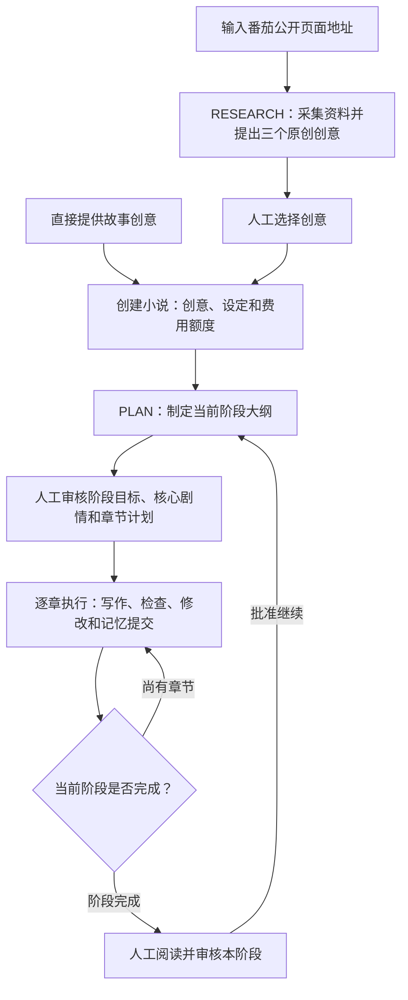
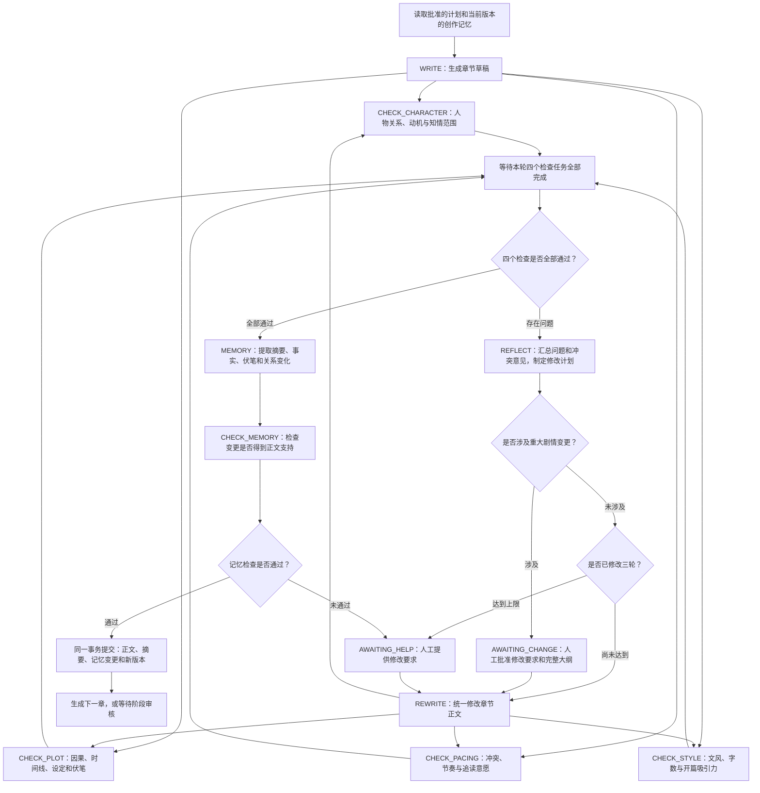
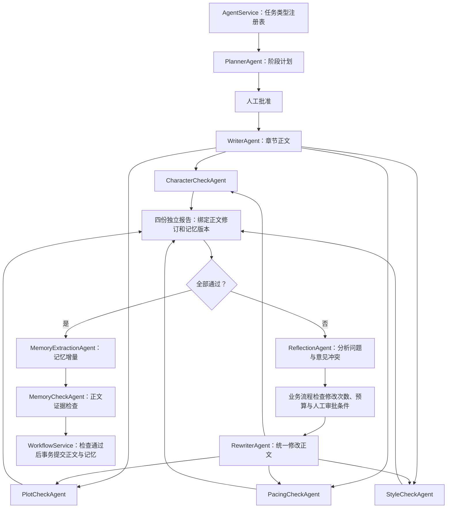
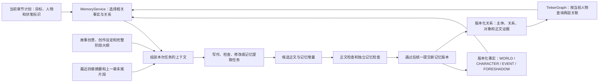
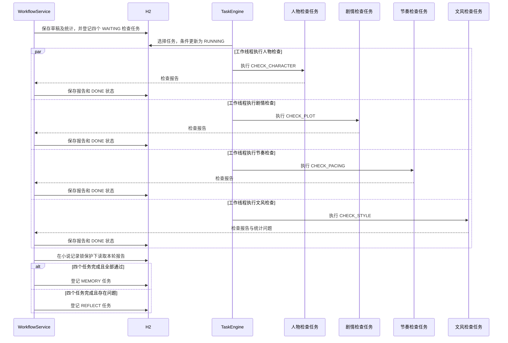
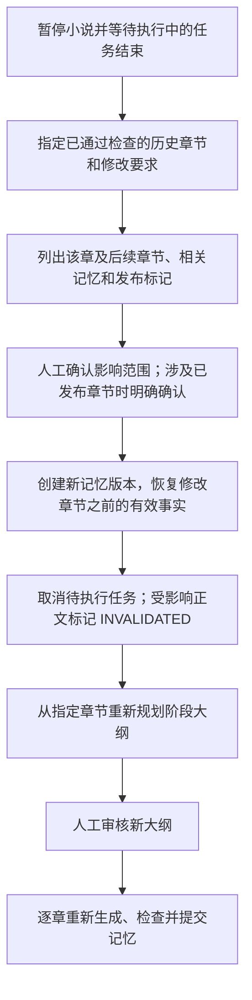
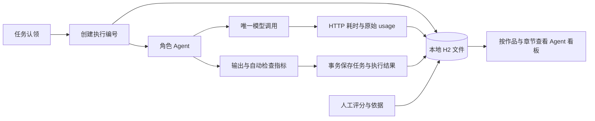

# Novel Agent

面向中文网文持续连载的个人创作工作台，使用 Java 17、Spring Boot、AgentScope Java、MyBatis、Redisson、H2 和 Apache TinkerGraph。通过阶段规划、逐章写作、并行检查和修改流程维护剧情，人工负责选题、阶段审核及重要剧情变更。

## 框架与执行层

AgentScope Java 固定为 `2.0.4`，使用 `agentscope-core` 与 `agentscope-extensions-model-openai`。该版本支持 Java 17。MyBatis Spring Boot Starter 使用 `3.0.5`，Redisson 使用 `3.52.0`。



`AgentScopeExecutor` 创建 `ReActAgent`，通过 `UserMessage` 提交任务，用 `GenerateOptions` 指定 JSON object、输出上限及单次尝试。`MiddlewareBase.onReasoning` 保存任务级推理事件。每个任务都有独立的 Agent 上下文，业务模块提供相应版本的小说记忆；四个检查任务分别执行，可以并发调用不同角色。

`OpenAIChatModel` 负责消息格式、请求生成与模型响应处理。`AccountedTransport` 包装框架的 `JdkHttpTransport`，在真实请求发送前检查上下文、取得限流许可并保存费用预留，在响应返回后保存 token、费用与原始结果。单个任务最多发送一次模型请求，框架重试次数设为1，内容修改由章节流程控制。服务中断、人工审核、已保存结果恢复和正文记忆事务由持久化业务流程管理。

MyBatis 负责全部业务数据库访问。`repository/mapper` 中的接口处理任务认领与模型调用状态，`resources/mappers` 按小说、任务、章节、记忆、选题、费用、质量、修改申请和事件组织 SQL；`Store` 使用 `SqlSessionTemplate` 调用命名语句并提供事务入口。Mapper 参数通过 `#{...}` 绑定，业务服务通过命名操作访问数据。CLOB 转换和 Map 字段名称在 MyBatis 配置中统一处理，事务内部查询采用 `STATEMENT` 本地缓存范围。

`ModelCallMapper` 提供费用汇总、预算锁、预留记录、响应检查点、结算和中断恢复等具体方法；`MemoryMapper` 提供版本快照、历史修改基准与记忆写入。`ModelCallReservation`、`ModelCallCheckpoint`、`MemoryEntry` 记录明确的参数与返回字段。费用预留使用 Spring `@Transactional`，调用资料、技能指纹、请求正文和框架版本通过一条 INSERT 保存；同一次预留使用一致的费用月份。模型 HTTP 请求位于费用预留事务之外。其他业务仍使用 `Store` 的命名语句入口。

每次执行在预留前生成独立 `callId`，响应结算和异常状态使用该标识更新所属记录。相同任务的并发预留仍受数据库唯一约束限制，预留失败的一方无法修改另一方的调用状态。

## Agent 输出与上下文处理

`dto/AgentOutputs` 使用 Java record 声明大纲、正文、检查报告、节奏、修改计划、记忆增量及选题结构。`AgentOutputReader` 使用 Jackson 映射和 Bean Validation 检查字段类型、必填项、嵌套列表、文本长度和取值范围。布尔字段接收 JSON boolean，章节编号接收 JSON integer，文本字段接收 JSON string；字段类型不匹配时明确失败。额外字段继续保存在原始响应中，任务结果仍使用 JSON 提交给工作流。

`PlanValidator` 检查章节数量与连续编号，`ReviewValidator` 检查报告结论及正文原文证据，记忆模块检查事实 key、关系 key 与证据，选题模块检查引用是否来自已采集资料。结构检查和业务校验分别维护，不增加隐式模型重试。

`MemoryService.contextData` 返回上下文对象，`TruthDocumentService` 直接组装按角色选择的资料。一次上下文构建读取一份版本快照，graph 构建和事实排序共用该快照。规划记忆按分类和数量上限收集，每条选中记录的 JSON 内容解析一次。对外保留 JSON 文本入口，内部对象通过 Jackson `valueToTree` 转换，避免字符串生成后再次解析。

启用 Redis 后，`ModelRateLimiter` 使用 Redisson `RRateLimiter` 共享每分钟调用额度，超限任务延后调度。连接中断会明确报告失败；费用与请求状态继续由数据库记录。数据库的60秒调用数量检查同时保留，Redis 清空后仍受已有调用记录约束。Redis 许可在数据库预留前取得，预留失败时许可仍计入当前一分钟，限流结果保持保守。此项目当前采用单个应用进程与 H2 文件数据库，多实例部署还需要共享数据库和执行所有权管理。

框架学习入口：`AgentScopeExecutor` → `ModelClient` → `TaskEngine` → `TaskDispatchMapper` / `ModelCallMapper` → 对应 Mapper XML → `ModelRateLimiter` / `RedisConfiguration`。

## 固定加载写作技能

项目固定使用 [fanqie-novel-skill](src/main/resources/skills/fanqie-novel-skill/SKILL.md) `v2.0.1`，作者 Jayce，来源为 `304769384-png/fanqie-novel-skill`，提交 `7d874e032d2de3dace74ae585cd2dbfbac2cde69`。上游文件原文随项目保存，来源及 SHA-256 记录在 [origin.properties](src/main/resources/skills/fanqie-novel-skill/origin.properties)。

每次模型调用和结果恢复都会加载技能主文件及相应角色的参考资料，并校验文件指纹。缺少必需文件或内容与固定版本不一致时明确失败。模型调用记录保存技能版本、加载文件清单、内容指纹及实际请求正文；API key 通过请求头发送，独立保存在本机配置中。

项目开发的固定读取规则写入 [AGENTS.md](AGENTS.md)。运行时通过 `SkillService` 加载技能，将写作规则、检查规则和数据库中的 Truth Files 提供给各角色。平台政策和收益依据经核实的官方资料判断；技能中的写作建议用于创作和检查。

## 创作工作流

一部小说由连续的故事阶段组成，每个阶段默认10章，创建作品时可以设置为1至20章。阶段审核通过后继续规划下一阶段，整部小说不预设完结章数。人工审核、费用额度及电脑运行状态决定任务何时继续。



选题研究可以填写自己的想法，包括题材、人设、读者期待、情节要求和不希望出现的内容；参考链接可选，最多提供五个番茄公开页面。想法或链接至少填写一项。提供链接时使用 Jsoup 读取，保存 URL、标题、采集时间和文字摘录；仅提供想法时进行原创构思，报告明确说明资料范围。

每份报告提供三个完整方案。报告下方支持持续讨论，例如调整主角职业、加强悬疑或比较方案；Agent 直接回应意见，并更新三个方案。用户与 Agent 的交流、每轮方案和调用记录持久化保存，可以查看历史并选择当前方案创建作品。每份报告同时执行一轮讨论，任务失败时沿用已有费用核对与人工重新执行流程。

讨论输入包含最初想法、当前三个方案、已采集资料和最近12条交流；全部交流历史继续保存在数据库。网页定期更新任务进度，并保留尚未发送的输入。界面使用亮色主题，桌面采用想法输入与方案讨论的双栏布局，手机宽度下顺序展示。

阶段大纲包含 `stageGoal`、`coreMilestones`，以及每章的编号、标题、目标、出场人物和关联伏笔。人工可以修改完整大纲，批准后开始正文生成。

## 每章的 Plan–Execute–Check–Reflect 流程

Plan 对应已批准的阶段及章节计划。Execute 生成正文，Check 独立检查正文，Reflect 仅在检查发现问题时执行。正文通过后还有一次独立的记忆检查。



| 任务 | 负责内容 | 输出 |
| --- | --- | --- |
| `RESEARCH` / `RESEARCH_CHAT` | 依据个人想法和可选资料提出、讨论原创选题 | 回复、三个完整创意及来源 |
| `PLAN` | 阶段冲突、剧情节点和章节安排 | 阶段大纲 |
| `WRITE` / `REWRITE` | 生成或统一修改章节 | 标题、正文 |
| `CHECK_CHARACTER` | 人物关系、动机、性格与知情范围 | 结论、正文证据和修改建议 |
| `CHECK_PLOT` | 因果、时间线、世界规则、伏笔与大纲执行 | 结论、正文证据和修改建议 |
| `CHECK_PACING` | 冲突推进、失败代价、信息揭示、高潮与缓和 | 结论、正文证据和修改建议 |
| `CHECK_STYLE` | 文风、重复表达、语义完整性、字数与开篇吸引力 | 检查结论及程序统计的问题 |
| `REFLECT` | 汇总检查意见，处理相互冲突的建议 | 统一修改计划、重大变更标记 |
| `MEMORY` | 提取本章记忆增量 | 摘要、事实与关系变更 |
| `CHECK_MEMORY` | 核对记忆变更与正文、历史设定 | 检查结论及问题证据 |

每个角色由独立任务、提示词及结构化输入输出定义，任务在同一 Java 应用中执行。检查角色提交报告，正文由写作角色统一修改，记忆由流程模块统一提交。

## 独立 Agent 与信息范围

系统采用工作流式多 Agent 协作，`agent` 包提供11个独立 Spring 组件，处理12种任务。`ResearchAgent` 同时处理选题与选题讨论，其他组件分别负责规划、写作、修改、人物检查、剧情检查、节奏检查、文风检查、反思、记忆提取和记忆检查。`AgentService` 负责类型注册、响应恢复、分发和分析查询，启动时检查遗漏或重复的任务类型。



角色组件保持无会话状态，每次任务创建独立的 AgentScope `ReActAgent`。`AgentContextService` 根据角色声明的 Truth Files 清单提供输入，并校验当前记忆版本、正文修订。正式事实继续使用数据库中的统一版本，角色通过任务结果协作，检查角色之间不传递尚未完成的报告。

| Agent | 额外输入范围 |
| --- | --- |
| PlannerAgent | 创作设定、历史计划、规划记忆、最近八章摘要、修改要求 |
| WriterAgent / RewriterAgent | 基础故事资料、人物关系、知情范围、文风与对话要求；修改角色增加原正文和修改计划 |
| CharacterCheckAgent | 基础故事资料、人物关系和知情范围、当前正文 |
| PlotCheckAgent | 基础故事资料、当前正文 |
| PacingCheckAgent | 基础故事资料、近期质量、对话及循环模式记录、当前正文统计 |
| StyleCheckAgent | 基础故事资料、文风及对话记录、当前正文统计 |
| ReflectionAgent | 基础故事资料、当前正文、四份独立检查报告 |
| MemoryExtractionAgent / MemoryCheckAgent | 基础故事资料、人物关系、知情范围与正文；记忆检查增加待提交增量 |
| ResearchAgent | 用户想法、已采集资料、当前方案与最近交流 |

基础故事资料包含设定、大纲、当前状态、待处理伏笔、交接记录和审核规则。规划输入单独组装，提供规划需要的分层记忆。只有节奏与文风等需要质量记录的角色读取相应统计。

`GET /api/agents` 提供任务类型、组件名称、职责和上下文清单。`GET /api/agents/metrics` 按角色任务类型统计完成、失败、等待、取消、调用次数、输入输出 token、已结算费用、待结算预留和不确定调用，支持 `?novelId=作品ID`。统计覆盖数据库保留的全部历史记录；历史取消任务保留在统计中。`AGENT_STARTED` 事件记录组件名称、任务类型、正文修订、记忆版本和上下文清单，用于关联任务、模型调用及检查结果。

线程池由 Spring `ThreadPoolTaskExecutor` 管理，默认4个工作线程，线程及队列都有明确上限，关闭时按模型调用超时等待任务完成。持久化调度、四份报告汇总、人工审核和正式记忆提交由业务流程负责。

检查报告需要引用当前正文中至少4个字符的原文。程序校验证据是否存在、结论与问题列表是否一致；模型负责评价语义和阅读节奏。正文目标长度为2000至2500个非空白字符；写作结果首先接受1800至3800个字符的格式检查，再由 `CHECK_STYLE` 将目标字数问题交给修改流程处理。

对话占比按含引号的非空行数除以全部非空行数计算，超过40%进入修改流程。节奏检查记录开头、主要活动、结尾、冲突解决方式、叙事模式、高潮及战斗标记。每五章结合此前四章回顾叙事模式，每十章结合此前九章摘要和质量记录按完整维度回顾。

自动修改最多三轮，且始终受费用额度限制。修改涉及核心剧情、人物重要转变、关键伏笔答案或阶段结局时等待人工批准。人工批准后可以明确发起新的修改轮次。记忆检查失败也进入人工处理，批准修改后重新执行正文检查及记忆提取。

## 持续连载的上下文与记忆

完整正文和历史资料长期保存在数据库，每次模型调用按当前章节组装上下文。阶段规划和章节创作使用不同的资料范围。



### 记忆保存

| 数据 | 保存方式 | 用途 |
| --- | --- | --- |
| 当前正文 | `chapters` | 阅读、检查和导出 |
| 正文修改历史 | `chapter_history` | 保留被替换的正文版本 |
| 世界规则、人物、事件、伏笔 | `memories` 中的版本化事实 | 规划与生成时查询 |
| 人物关系与知情范围 | `memories` 中的 `RELATION` 记录 | 构建指定版本的 graph |
| 阶段大纲 | `novels.plan` | 控制当前阶段剧情 |
| 任务和调用记录 | `tasks`、`model_calls`、`events` | 恢复执行、核对费用和追踪问题 |

事实沿用稳定的 `key`；关系使用 `subject`、`predicate`、`object` 标识，并保存来源章节和原文证据。例如，人物掌握某个秘密使用 `KNOWS` 关系，秘密作为对象。结束的关系通过 `deleted=true` 标记；伏笔回收沿用原 `key` 并设置 `active=false`。

关系记录持久化在 H2，查询时使用指定记忆版本构建 TinkerGraph。网页支持一至三层关联查询，章节上下文默认查询两层关联。

### 本章上下文选择

- 根据出场人物、关联 graph 节点、明确指定的伏笔、预计回收章节和近期事件选择事实。
- 按评分提供最多50条事实，并记录未提供的匹配数量。
- 提供最近四章已通过检查的摘要，每十章回顾时扩展为九章；上一章末尾片段最多4000个字符。
- 同时提供故事创意、创作设定、完整阶段大纲及本次读取的记忆版本。
- 系统提示、技能和用户消息序列化后的 UTF-8 字节数默认上限为120000，超过上限时任务明确失败并等待处理。

阶段规划读取最近八章摘要，并分别选择最多15条世界规则、15条人物记忆、15条事件和30条仍然有效的伏笔。原始资料继续保留在数据库。

记忆提取每章最多产生40条事实与关系变更，每条变更需要正文证据。通过检查后，正文转为 `ACCEPTED`，摘要、记忆变更和 `memory_version` 在同一事务内提交。后续章节读取新版本；旧记忆版本下执行的任务不能提交为当前结果。

### Truth Files 与质量记录

写作前的 `current_state.md`、`outline.md`、`pending_hooks.md`、`handoff_current.md`、`progress_tracker.md`、`dialogue-monitor.md` 和 `pattern-detection.md` 等资料由当前数据库状态生成，以命名文档的形式提供给角色。任务无需等待用户重复提供交接文件。

网页的“质量记录”展示字数、对话占比、趋势和叙事结构；“交接资料”展示13份状态文档，并支持 ZIP 导出。正式章节提交后，这些资料依据新的正文与记忆版本生成。历史修改后的质量记录只统计当前仍然有效的正文版本。

## 多任务并发与持久化编排

`TaskEngine` 每500毫秒检查可执行任务，默认使用4个工作线程。多部小说独立推进，同一部小说按章节依赖生成；某章生成完成后，四个正文检查任务可以并行执行。



实际并发数量取决于空闲工作线程和调用限额。选择任务时优先考虑当前执行任务较少的作品，再根据任务时间排序。

任务记录包含作品、任务类型、章节、修改轮次、记忆版本、输入、输出和错误。`task_key` 由作品、阶段、章节、修改轮次、记忆版本和任务类型组成，数据库唯一约束与应用检查共同防止重复登记同一步骤。

流程结果提交时锁定对应小说记录，串行判断本轮是否已经完成，再登记下一步任务。正文检查之间可以并行，影响同一小说进度的状态提交受数据库事务保护。

### 费用与速率限制

每次调用先检查上下文字节数，再在预算记录锁保护下检查速率和相应额度、预留费用，随后请求所选模型。

模型服务支持 `metered` 与 `unmetered`。计费服务使用原有人民币预算规则；免费服务的预留和实际费用为零，保留输入、输出 token 及完整调用记录。历史费用持续保留，计费额度用尽时仍可使用免费服务；全部服务共享调用速率限制。

| 配置 | 默认值 | 范围 |
| --- | --- | --- |
| `novel.workers` | 4 | 全部作品共享的工作线程数量 |
| `novel.model.requests-per-minute` | 30 | 全部模型调用共享的滚动60秒限额 |
| `novel.monthly-budget` | 300元 | 按北京时间月份统计的总额度 |
| 作品月额度 | 100元 | 创建作品时设置 |
| 章节调用额度 | 5元 | 创建作品时设置，累计该章节全部任务费用 |

速率达到上限时，任务延后5秒重新等待调度。费用额度不足时，该作品进入 `BUDGET_PAUSED`，已有进度保留。供应商返回 token 用量后，按配置的人民币单价结算，并保存本次调用使用的模型和单价。

阶段规划任务也带有章节编号，其费用计入对应章节额度。输入费用预留依据消息字节数估算；实际费用超过预留金额时，任务停止并要求核查供应商单价及 token 规则。

一章直接通过时，写作、四个正文检查、记忆提取和记忆检查共执行七次模型调用。阶段规划和需要的 Reflect、Rewrite 另行计费。技能内容计入上下文检查和费用预留。

### 暂停、失败与重启恢复

- **主动暂停**：停止继续推进该作品；已发出的调用仍可能完成和计费。结果保存为 `READY`，恢复后继续处理。
- **任务失败**：任务进入 `ERROR`，所属小说暂停；其他作品继续执行。人工可以明确重新执行失败任务。
- **重启恢复**：此前处于 `RUNNING` 且没有结果不确定调用的任务重新进入等待调度。已保存的任务结果或 `COMPLETE` 模型响应可以复用。
- **调用结果不确定**：此前处于 `IN_FLIGHT` 的调用转为 `UNCERTAIN`，保留费用预留。人工在供应商后台核对实际费用后，才能明确重新执行关联任务。

## 历史章节修改

当前影响分析保守包含修改章节及全部后续章节，同时列出来源章节位于该范围内的当前记忆。批准操作会使受影响正文等待重新生成。



历史记忆版本保留，正文被替换前保存到 `chapter_history`。修改请求记录创建时的记忆版本；批准时若版本已变化，需要重新分析影响范围。结果不确定的调用需要完成费用核对后才能批准历史修改。

## 启动与配置

运行环境需要 Java 17 或更高版本。项目自带 Maven Wrapper；当前 `start.ps1` 使用本机路径 `C:\Program Files\Java\jdk-17`，其他电脑需要调整脚本中的 `JAVA_HOME`。

在 PowerShell 中执行：

```powershell
Set-Location 'D:\java_learning\novel-agent'
Copy-Item -LiteralPath 'config\application-local.example.yml' -Destination 'config\application-local.yml'
```

编辑 `config/application-local.yml`，填写供应商配置。该文件只保存在本机。现有计费服务沿用以下配置：

| 字段 | 内容 |
| --- | --- |
| `novel.model.endpoint` | `/v1` 基础地址或完整 Chat Completions 地址；远程使用 HTTPS，本机允许 HTTP |
| `novel.model.api-key` | API key |
| `novel.model.name` | 模型名称 |
| `novel.model.input-per-million` | 每百万输入 token 的人民币价格，必须大于零 |
| `novel.model.output-per-million` | 每百万输出 token 的人民币价格，必须大于零 |
| `novel.model.billing-mode` | `metered` 表示按 token 计费 |

多个服务配置在 `novel.providers.<id>` 下，每个服务包含 `display-name`、`endpoint`、`api-key`、`name` 和 `billing-mode`。计费服务还需设置 `input-per-million`、`output-per-million`；免费服务设置 `billing-mode: unmetered`。`novel.default-provider` 指定新作品和选题研究使用的默认服务，`default` 指向原有 `novel.model` 配置。

前端创建作品和作品概况页面提供服务、模型下拉选项，模型列表从所选服务读取。服务地址及 API key 保存在服务端本机配置，接口只提供名称和计费方式。作品创作中可暂停并等待当前任务结束后切换；等待人工审核或处理失败时也可以切换。选择仅影响后续模型调用，已保存结果与费用记录继续保留。未指定具体模型时使用服务默认模型；原有服务继续支持按角色配置。

模型需要支持 `response_format: json_object`、`max_tokens`，并返回 `usage.prompt_tokens`、`usage.completion_tokens`。也可以使用 `NOVEL_MODEL_ENDPOINT`、`NOVEL_MODEL_API_KEY`、`NOVEL_MODEL_NAME`、`NOVEL_INPUT_PRICE`、`NOVEL_OUTPUT_PRICE` 环境变量。`novel.agents` 下可以按角色分别配置模型名称、地址、密钥及价格；未单独配置的字段使用 `novel.model` 中的值。

选题研究表单和每份报告的讨论输入框也提供“模型服务”“文本模型”选项。初次研究使用所选服务和模型；讨论默认沿用该报告最近保存的选择，也可以在发送前切换。新任务保存明确的 provider 和 model_name，恢复与人工重新执行继续使用该任务的选择，费用记录保留每次实际调用的信息。历史报告可从已有调用记录读取模型信息。

模型列表正在读取、服务尚未配置或列表读取失败时，选题提交按钮保持禁用；讨论已有待处理任务时，模型选择与发送按钮禁用。页面自动更新会保留当前选择。升级后需要重启后端并刷新页面；前端检查后端是否支持选题模型选择，确认支持后开放提交。API key 和服务地址继续保存在本机配置中。

模型列表读取失败时，页面显示对应服务与具体原因，并提供“重新读取模型列表”按钮；重新读取保持当前服务选择。连接失败返回502、请求超时返回504，请求中断返回503；鉴权与上游响应错误也通过结构化错误说明。日志记录服务标识和错误类别，凭据及响应正文保留在输出范围之外。本地服务需要启动后才能读取其模型列表。

```powershell
.\start.ps1
```

脚本默认启用 Redisson，并使用 `start-redis.ps1` 检查或启动本机 Redis。当前 Redis 程序目录为 `D:\Program Files\Redis-x64-5.0.14.1`，只监听 `127.0.0.1:6379`，项目数据保存在 `data/redis`。已经运行的 Redis 会继续使用。脚本随后构建项目，将 JAR 复制到独立的运行目录，以 `local` profile 启动。访问 [本地创作工作台](http://127.0.0.1:8096)。服务默认仅监听本机地址。

IDEA 的 Run Configuration 使用 Java 17，启用 `local` profile，并设置环境变量 `NOVEL_REDIS_ENABLED=true`。可以单独执行 `.\start-redis.ps1` 启动 Redis。外部 Redis 通过 `NOVEL_REDIS_ADDRESS`、`NOVEL_REDIS_PASSWORD` 配置，使用独立 key 范围时设置 `NOVEL_REDIS_PREFIX`。这些选项也可以保存在本机配置的 `novel.redis` 下。配置启用 Redis 后，连接失败会阻止启动或模型调用。

直接启动 Java 应用时，`novel.redis.enabled` 默认 `false`，使用数据库调用数量限制；启用后叠加 Redisson 共享限流。`/api/status` 返回 `agentFramework`、`persistence` 与 `rateLimiter`，方便确认当前配置。

网页操作顺序：选题研究或直接创建作品 → 阶段大纲审核 → 查看章节和执行记录 → 处理修改或费用待办 → 阶段阅读审核 → 继续下一阶段。正文可以导出为文本文件，发布及平台正文修改由人工完成。

数据库默认位于 `data/novel`。`data/`、`target/`、`.work/`、日志、`.env` 和 `config/application-local.yml` 已加入 Git 忽略规则。

## Agent 观测看板

网页左侧的 **Agent 看板** 提供全部作品和选题任务的统计；作品内也有同名页面。支持作品、章节、Agent、任务状态筛选及分页，每5秒更新；编辑筛选或打开任务详情时暂停自动刷新。

- **开销**：每个 Agent 的调用次数、输入与输出 token、缓存输入 token、已结算费用、未结算预留金额。费用以唯一模型调用汇总，恢复执行不会重复累计费用。缓存用量只记录供应商报告值，未报告时保留空值；费用继续按配置单价估算，尚未应用缓存折扣。
- **时间**：每次执行的开始、结束、排队及执行耗时，模型 HTTP 等待时间单独记录。并行任务的耗时分别累计，累计执行时间不等于作品生成的实际等待时间。
- **效果**：正文字符数、检查是否通过、问题数量、重大变更标记、提取事实及关系数量，以及完整输出。检查统计按任务去重，包含正文与记忆检查。自动检查通过率不能代表读者满意度；任务有有效输出后，可以提交1至5分的人工评价及依据，保留每次评价，统计采用最新评分。
- **追踪**：任务详情关联各次执行、模型调用、AgentScope 事件、输出及人工评价；调用和角色事件携带执行编号。角色为固定组件，`kind` 区分 ResearchAgent 的两类任务。

任务认领与执行记录创建使用同一事务，任务结果与执行结束记录也在同一事务内保存。模型响应后的原始 usage 和 token 保存在调用记录。服务启动时将未结束执行标记为 `INTERRUPTED`，结束时间和最终耗时保留未知；已有模型费用恢复流程继续处理结果不确定的调用。限流等待和线程拒绝分别记录，后续执行产生新的执行编号。

全部记录保存在本地 H2 文件 `data/novel.mv.db`，包含已有的 `tasks`、`model_calls`、`events` 和新增的 `agent_executions`、`agent_feedback`。关闭网页、重启服务后仍可查询；`data/` 已加入 Git 忽略规则。新增字段和表通过幂等 SQL 创建，历史任务继续显示已有结果与费用，缺失的耗时显示“未记录”。迁移不会根据旧事件猜测执行耗时。



接口：`GET /api/observability`，参数为 `novelId`、`chapter`、`kind`、`status`、`page`（从0开始，每页30个任务）；`GET /api/observability/tasks/{id}` 提供任务详情；`POST /api/observability/tasks/{id}/feedback` 接收 `rating` 和 `note`。详情不包含模型请求正文，事件页面显示最近500条；全部事件继续保留在数据库。

## 本地日志与选题进度

启动后，IDEA Console 和本地文件 `data/logs/novel-agent.log` 同时显示任务关键事件。日志包含 `taskId`、`executionId`、Agent 类型、模型名称、HTTP 状态、耗时及 token 用量；请求正文、API key 和请求头不进入这些事件日志。事务中的事件在提交后输出，数据库中继续保留原始事件记录。

执行期间每15秒输出一次 `TASK_RUNNING`，说明当前阶段、执行时间和模型等待时间。`MODEL_REQUEST_SENT` 表示进入模型请求阶段，`MODEL_RESPONSE_RECEIVED` 表示收到完整 HTTP 响应，`MODEL_USAGE_RECORDED` 表示用量已保存。当前采用完整响应模式，等待期间没有已完成的正文 token 统计；响应返回后显示用量和费用。

日志文件使用 UTF-8，按10MB轮转，保留14天，总容量上限200MB；通过 `NOVEL_LOG_FILE` 可以修改输出位置。默认日志位于 Git 忽略的 `data/` 目录。PowerShell 持续查看：

```powershell
Get-Content -LiteralPath 'D:\java_learning\novel-agent\data\logs\novel-agent.log' -Tail 80 -Wait -Encoding UTF8
```

选题研究与讨论页面每5秒读取持久化进度，展示任务阶段、已执行时间、模型等待时间、最近事件和错误；状态未变化时继续更新时间，填写中的内容会保留。回复完成后可以点击“查看生成过程、耗时与费用”查看关联任务。时间显示采用北京时间。

`GET /api/observability/tasks/{id}/progress` 返回轻量进度信息和最近12条事件，不返回任务输入或模型输出；全部历史与原始输出继续通过任务详情查询。执行阶段根据已保存的任务、调用及事件计算。

## 代码入口

后端采用 MVC 分层。`NovelApplication` 位于根包，`controller` 处理 HTTP 路由与响应，`dto` 定义请求和参数校验，`service` 承担业务流程，`repository` 封装 MyBatis 访问与事务，`repository/mapper` 保存 Mapper 接口。模型接入位于 `integration/model`，持久化任务调度位于 `engine`，框架配置位于 `config`，JSON 工具位于 `support`。Controller 通过 service 访问业务数据。

| 文件 | 职责 |
| --- | --- |
| [NovelController.java](src/main/java/dev/novel/controller/NovelController.java) | 小说、章节与审核接口 |
| [ResearchController.java](src/main/java/dev/novel/controller/ResearchController.java) | 选题和报告交流接口 |
| [SystemController.java](src/main/java/dev/novel/controller/SystemController.java) | 状态、模型服务与费用接口 |
| [ApiRequests.java](src/main/java/dev/novel/dto/ApiRequests.java) | 请求 DTO 和参数校验 |
| [Store.java](src/main/java/dev/novel/repository/Store.java) | 数据库查询、写入及事务访问 |
| [WorkspaceService.java](src/main/java/dev/novel/service/WorkspaceService.java) | 工作台查询、发布标记及正文导出 |
| [ResearchService.java](src/main/java/dev/novel/service/ResearchService.java) | 个人想法、资料采集、选题讨论和交流记录 |
| [WorkflowService.java](src/main/java/dev/novel/service/WorkflowService.java) | 完成步骤、汇总检查、安排下一步及统一提交 |
| [TaskEngine.java](src/main/java/dev/novel/engine/TaskEngine.java) | 调度、工作线程、失败处理和启动恢复 |
| [AgentService.java](src/main/java/dev/novel/service/AgentService.java) | 独立 Agent 注册、分发、结果恢复和分析查询 |
| [NovelAgent.java](src/main/java/dev/novel/agent/NovelAgent.java) | 角色任务类型、职责与上下文清单 |
| [AgentContextService.java](src/main/java/dev/novel/agent/AgentContextService.java) | 按角色提供资料、检查记忆与正文版本 |
| [AgentOutputs.java](src/main/java/dev/novel/dto/AgentOutputs.java) | Agent 输出 DTO 与 Bean Validation 约束 |
| [AgentOutputReader.java](src/main/java/dev/novel/agent/AgentOutputReader.java) | Jackson 类型映射与嵌套字段验证 |
| [TaskExecutionConfiguration.java](src/main/java/dev/novel/config/TaskExecutionConfiguration.java) | Spring 任务线程池与关闭流程 |
| [MemoryService.java](src/main/java/dev/novel/service/MemoryService.java) | 版本化事实、graph 查询和上下文组装 |
| [ProjectService.java](src/main/java/dev/novel/service/ProjectService.java) | 人工审批、暂停恢复和历史修改 |
| [ModelClient.java](src/main/java/dev/novel/integration/model/ModelClient.java) | 模型配置选择、响应复用、请求和结算 |
| [AgentScopeExecutor.java](src/main/java/dev/novel/integration/model/AgentScopeExecutor.java) | ReActAgent、OpenAIChatModel、MiddlewareBase 与请求费用扩展 |
| [ModelRateLimiter.java](src/main/java/dev/novel/integration/model/ModelRateLimiter.java) | Redisson 模型调用限流 |
| [TaskDispatchMapper.java](src/main/java/dev/novel/repository/mapper/TaskDispatchMapper.java) | MyBatis 任务候选查询与条件认领 |
| [ModelCallMapper.java](src/main/java/dev/novel/repository/mapper/ModelCallMapper.java) | MyBatis 模型响应、费用与调用状态写入 |
| [MemoryMapper.java](src/main/java/dev/novel/repository/mapper/MemoryMapper.java) | MyBatis 记忆快照、历史基准及增量写入 |
| [MyBatisConfiguration.java](src/main/java/dev/novel/config/MyBatisConfiguration.java) | 字段映射、CLOB 类型与本地缓存配置 |
| [RedisConfiguration.java](src/main/java/dev/novel/config/RedisConfiguration.java) | Redisson 连接配置与生命周期 |
| [ModelCatalog.java](src/main/java/dev/novel/integration/model/ModelCatalog.java) | 服务配置、模型列表和小说模型选择 |
| [BudgetService.java](src/main/java/dev/novel/service/BudgetService.java) | 并发费用预留、速率检查及费用核对 |
| [SkillService.java](src/main/java/dev/novel/service/SkillService.java) | 固定技能加载、角色参考资料选择和指纹验证 |
| [ChapterQualityService.java](src/main/java/dev/novel/service/ChapterQualityService.java) | 正文统计、字数和对话占比检查、质量历史 |
| [TruthDocumentService.java](src/main/java/dev/novel/service/TruthDocumentService.java) | 当前状态文档、交接资料和 ZIP 导出 |
| [schema.sql](src/main/resources/schema.sql) | 作品、任务、章节、记忆及调用记录表 |

## 验证范围

1.6.1 的6项相关数据库与 HTTP 检查通过；真实 DeepSeek 完成一次选题和一次讨论，验证轻量进度、模型调用阶段、用量、本地日志、回复记录入口及编辑内容保留。Playwright 使用本机 Edge，在1440×1000和390×844窗口验证交互及横向尺寸，未使用截图。两次配置估算费用合计0.083446元，资料保存在独立验证数据库；文学质量、Redis 与全部角色组合、长期连载仍需继续验证。

观测功能还使用真实 H2 文件验证重启保留、执行恢复、费用与检查统计去重、人工评价历史及接口参数。费用统计检查中的记账资料与真实模型调用分别记录；全局及作品看板、筛选、详情与人工评价交互已验证。

```powershell
$env:JAVA_HOME = 'C:\Program Files\Java\jdk-17'
.\mvnw.cmd -B -ntp package
```

自动验证使用真实 H2 数据库、TinkerGraph 和本地 HTTP 接口，覆盖并发费用预留、速率限制、关系历史查询、证据校验、事务完整性、人工审核、历史修改、恢复及失败隔离，同时验证固定技能、正文统计、质量历史、交接资料和 ZIP 导出。具体版本的验证结果记录在 [CHANGELOG.md](CHANGELOG.md)。

`RedisIntegrationTest` 使用真实 Redis 和两个独立 Redisson 客户端，检查并发共享额度与重新连接后的额度保留。默认不执行，设置 `NOVEL_REDIS_TEST=true` 后可以运行。真实模型检查增加框架版本和 Middleware 事件记录核对。

`LiveModelTest` 默认不执行。配置真实模型并设置 `NOVEL_LIVE_TEST=true` 后，可以运行真实模型验证；计费服务按配置单价计算费用，免费服务记录零费用。

```powershell
$env:NOVEL_LIVE_TEST = 'true'
.\mvnw.cmd -B -ntp '-Dspring.profiles.active=local' '-Dtest=LiveModelTest' test
```

真实模型验证覆盖大纲、正文、四个并行检查及调用中的技能记录；正文检查通过时继续验证记忆提取与记忆检查。小说质量、长期连载中的检索准确率、动态榜单的可读取范围及实际收益需要结合真实运行评价。
