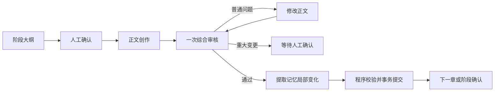

# Novel Agent

中文小说连载工作台。输入故事设定，确认阶段大纲，逐章生成、检查并保存正文和 Markdown 记忆。

## SDD 学习入口

重构从独立的 [Loop Lab](loop-lab/README.md) 开始，[SDD-001](docs/specs/001-agent-loop.md) 定义输入、工具、结束条件与验收标准。代码仅有一个 Agent、一个只读文件工具，使用 AgentScope 完成模型与工具循环。现有作品与程序保留，小说后台保持停止。

本地文件检查2项通过。真实模型验收需要本机8317服务，当前连接失败，尚未确认模型循环通过。

## 创作流程



四个业务组件分别负责规划、正文、审核和记忆。默认每章一次通过包含3次主要模型调用；工具读取、压缩和重试按实际请求计数。普通正文修改最多3轮，重大剧情变化、阶段完成和费用超限会停止自动推进。

审核只返回通过结论与有正文依据的问题，检查人物知情、物品、能力次数、因果、章纲目标、情节推进与表达。篇幅2000至2500个非空白字符作为参考，字数差异单独记录。

## 运行

需要 Java 17、Node.js 22.12以上。已有作品默认使用 `data/novel.mv.db`，正式记忆保存在 `data/books`，密钥和日志由 Git 忽略。

```powershell
Set-Location 'D:\java_learning\novel-agent'
.\start.ps1
```

后端地址 `http://127.0.0.1:8096`。启动脚本构建前端与后端，并启动本机 Redis 供模型限流使用；已经运行时复用。已有后端不能重复启动。

独立开发前端：

```powershell
Set-Location 'D:\java_learning\novel-agent\frontend'
npm.cmd ci
npm.cmd run dev
```

开发页面 `http://127.0.0.1:5173`，API 转发到8096。IDEA 共享配置为 `Novel Backend`、`Novel Frontend`、`Novel Fullstack`。MySQL 配置继续支持已完成数据迁移的环境；已有 H2 作品不能直接切换数据库配置。

账号通过页面注册，作品和任务按用户隔离。已有管理员账号资料在被忽略的 `config/auth-local.json`。模型服务配置在本机配置文件中维护，页面选择服务、模型与支持的思考强度。

## 记忆

正式记忆采用版本化 Markdown。模型读取目录、搜索或明确路径，只获取本章需要的资料。工具包括 `read_memory`、`list_memory_files`、`search_memory`、`read_memory_batch`、`read_plan`、`read_paragraph`、`read_source`。

记忆提取只输出必要的局部修改：

```json
{
  "summary": "陈岚接过钥匙。",
  "patches": [{
    "path": "characters/lin.md",
    "expectedHash": "读取文件返回的指纹",
    "content": null,
    "edits": [{"oldText": "钥匙由林舟保管。", "newText": "钥匙已交给陈岚。来源：第2章p0。"}],
    "description": "更新钥匙保管状态。",
    "evidencePaths": ["/paragraphs/p0"]
  }]
}
```

程序要求原文唯一匹配、修改范围互不重叠，保留其他内容；新主题使用完整 `content` 和空 `edits`。每章最多12个文件、每文件12处修改、输出最多32000字节。历史来源保持只读。

程序检查版本、路径、Markdown、稳定标识、链接、来源路径和关系唯一性，随后将正文、记忆清单及进度一起提交。校验失败保留原正式版本并报告原因，不启动自动记忆审核和修正循环。来源路径存在不能证明所有语义正确，仍需要阅读评价。

## 暂停、重试与费用

页面支持暂停和恢复。执行记录保存请求、响应、错误、耗时、token、缓存命中与费用。失败任务可在检查错误后重新执行；费用不确定的调用必须核对后才能重试。暂停期间完成的结果保存为 READY，恢复时重新检查版本。

保留作品月预算、单章预算、部署总预算与调用限流。实际用量取自服务响应，免费服务使用 `unmetered`；付费请求的结果不确定时不会直接重放。

## 开发与验证

后端使用 Spring Boot、AgentScope Java、MyBatis；前端使用 React、TypeScript、Vite、TanStack Query。Markdown 使用 CommonMark 与 YAML 库处理，差异记录使用 java-diff-utils。Redis 通过 Redisson 接入限流。

```powershell
.\mvnw.cmd '-Dfrontend.skip=true' '-Dtest=CoreWorkflowIntegrationTest,MemoryPatchIntegrationTest,MarkdownMemoryIntegrationTest' test
.\mvnw.cmd package -DskipTests
```

测试使用独立真实数据库及 HTTP 接口。真实模型验证必须明确选择环境并核对费用；开发验证不会自动执行用户小说任务。

- [流程与职责](docs/multi-agent-workflow.md)
- [代码目录](docs/project-structure.md)
- [验证范围](docs/agent-review-evaluation.md)
- [版本记录](CHANGELOG.md)
