# Novel Agent

面向中文网文持续连载的个人创作工作台，前端使用 React、TypeScript、Vite 与 TanStack Query，后端使用 Java 17、Spring Boot、AgentScope Java、MyBatis、MySQL、Flyway、Redisson 和 Neo4j，兼容已有 H2 数据及进程内 TinkerGraph 查询。通过阶段规划、逐章写作、并行检查和修改流程维护剧情，人工负责选题、阶段审核及重要剧情变更。MySQL 适配、Redis 记忆缓存与现有业务已通过独立环境验证，验证范围及真实模型结果见文末；已有作品数据尚未迁移到 MySQL。

整体流程、Agent 职责、人工处理位置与持久化机制见 [小说 Agent 流程与职责](docs/multi-agent-workflow.md)，包含逐章创作、协调委派、记忆处理及执行架构的 Mermaid 图。

代码目录职责、主要类与验证入口见 [项目结构与代码导航](docs/project-structure.md)。本机学习指南保存在 `C:/Users/cc/Documents/Obsidian Vault/小说agent/学习路线与代码阅读指南.md`，按业务状态、持久化调度、多 Agent、审核、记忆、费用恢复和用户隔离组织阅读顺序与完成标准。

后端接口返回类型按业务集中在 `dto/response`，Controller 使用明确的 record。`ResponseMapper` 将内部查询数据转换为声明字段，保留现有 JSON 命名、金额精度及未知用量的空值。费用、供应商和 Agent 查询分别由 `BudgetController`、`ProviderController`、`AgentController` 提供；主流程按草稿保存、审核汇集、反思处理和记忆提交组织独立方法。事务、任务认领、服务恢复和线程身份清理位置附有设计说明，代码入口见项目结构文档。

## 登录与用户隔离

启动后进入登录页面。已有作品、选题、任务及历史费用归入本地 `owner` 账号；首次启动自动生成随机密码，登录信息仅保存在已被 Git 忽略的 `config/auth-local.json`。普通用户通过页面注册，用户名为2至32个小写字母、数字或下划线，以字母开头；密码为4至64个字符，UTF-8 长度最多72字节。`owner` 名称保留，注册用户无法认领已有数据。

认证采用 Spring Security 会话，密码使用 BCrypt 保存，登录成功更换会话标识，退出后会话失效。会话 Cookie 为 HttpOnly、SameSite=Lax，写操作需要 CSRF token。会话空闲12小时失效；应用重新启动后重新登录，数据库中的用户及作品继续保留。本地管理员凭据文件也可通过 `novel.auth.bootstrap-file` 指定。

作品、选题与后台任务保存 `user_id`。后端对作品详情、导出、任务、费用核对及历史修改检查所有权，其他用户访问统一返回404；作品列表、选题列表、Agent 统计与费用记录在 SQL 查询中限定当前用户。新用户从空工作区开始。接口忽略浏览器传入的用户归属，使用服务端认证身份。

后台任务持久化所属用户，在工作线程中建立执行范围并在结束时清理；正文工具另外检查任务与作品所属用户一致。记忆缓存键包含用户、作品、版本和查询条件。前端退出时清理查询缓存，编辑草稿按用户名分别保存。单用户费用页面只显示本人用量与记录，供应商凭据和服务配置由部署端统一管理，部署端月度总预算与供应商限流仍作为共享上限。

接口：`GET /api/auth/csrf` 获取请求验证 token；`POST /api/auth/register` 提交 JSON 用户名与密码；`POST /api/auth/login` 提交表单编码的用户名与密码；`GET /api/auth/me` 查询登录身份；`POST /api/auth/logout` 退出。业务 API 均要求登录，注册、登录和退出的写请求也需要 `X-XSRF-TOKEN`。

MySQL 使用 Flyway V5 增加账号表、用户归属及索引，H2 使用幂等 schema 更新；历史数据统一归属 `owner`，不改变现有章节、记忆或费用内容。

## React 前端与 IDEA 运行

使用 IDEA 打开整个项目目录，重新加载 Maven 项目。前端代码位于 `frontend/src`，按页面、通用组件和数据访问模块组织。Node.js 需要22.12或更高版本，本机使用24.15。首次安装前端依赖：

```powershell
Set-Location 'D:\java_learning\novel-agent\frontend'
npm.cmd ci
```

项目的 `.run/` 目录提供共享运行配置，IDEA 右上角运行列表可选择：

| 配置 | 用途 |
| --- | --- |
| `Novel Frontend` | 执行 `frontend/package.json` 中的 `dev` 命令，地址为 `http://127.0.0.1:5173` |
| `Novel Backend` | 自动启动 Redis 与 Neo4j，使用项目 JDK 和 `local` profile 启动 Spring Boot，使用 H2，端口8096 |
| `Novel Fullstack` | 同时运行上述两个配置 |
| `Novel MySQL` | 检查并启动本机 MySQL Windows 服务 |
| `Novel Redis` | 检查并启动本机 Redis，已经运行时直接复用 |
| `Novel Neo4j` | 检查并启动本机 Neo4j，等待 HTTP 和 Bolt 接口就绪 |
| `Novel Backend MySQL` | 自动启动 MySQL、Redis 和 Neo4j，使用 `local,mysql` profiles 启动后端 |
| `Novel Fullstack MySQL` | 同时启动 MySQL 后端与前端，后端自动启动依赖 |

已有后端在 IDEA 运行时，只运行 `Novel Frontend`。后端配置需要 Java 17或更高版本；`npm` 配置需要 IDEA 启用 JavaScript/Node.js 功能，Node interpreter 使用本机 `D:\Program Files\NodeJs\node.exe`。中间件入口需要 IDEA 启用 Shell Script 插件，使用 Windows PowerShell 执行项目脚本。共享配置不包含密钥。

已有作品继续使用 `Novel Fullstack`；完成数据迁移后可以选择 `Novel Fullstack MySQL`。MySQL 连接信息读取被 Git 忽略的 `config/mysql-local.properties`，Neo4j 读取 `config/neo4j-local.json`。MySQL 服务已经运行时启动配置直接完成；服务停止时需要当前 IDEA 进程具备启动该 Windows 服务的权限。Redis 和 Neo4j 通过后台进程运行，IDEA 中结束启动脚本不会关闭这些服务。

开发页面使用5173端口；Vite 将 `/api` 转发到8096，保存 React 或 CSS 文件后执行热更新。后端端口改变时，在前端运行配置的环境变量中设置 `NOVEL_BACKEND_URL=http://127.0.0.1:实际端口`。本次升级包含新增后端接口，需要在 IDEA 重新启动后端后使用新版前端。

作品页面每2秒读取状态快照，返回状态、阶段、章节、记忆版本和最新事件编号；只有快照变化时才更新正文、大纲、记忆与交接资料。事件查询使用 `(novel_id,id)` 索引，侧栏列表只返回作品摘要。选题与任务进度每2秒更新，Agent 看板与费用每3秒更新；页面重新获得焦点时同步数据。数据更新通过 React 更新相应组件，自动同步不会覆盖输入；正在编辑的创意文字、大纲、修改意见与讨论内容保存在当前浏览器的 `sessionStorage`，页面切换和刷新后仍可读取。模型列表缓存5分钟，手动同步可主动重新读取。模型生成耗时仍由供应商响应决定。

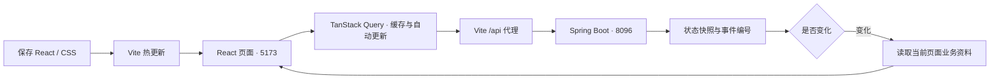

执行 `npm.cmd run build` 可单独检查 TypeScript 并构建前端。项目根目录的 `mvnw.cmd package` 自动执行 `npm install` 和前端构建，将产物打入 Java JAR；安装使用已有 lock 文件与依赖目录。打包后通过8096访问相同的 React 页面。前端依赖与产物分别保存在已忽略的 `frontend/node_modules`、`frontend/dist`，Node 仅在开发与构建时使用。已有前端构建产物时，可通过 `mvnw.cmd "-Dfrontend.skip=true" package` 跳过 npm 步骤。

失败任务卡片提供“选择模型并重新执行”入口。打开执行详情，在“选择本次重新执行的模型”中选择服务和模型，再点击“使用所选模型重新执行”。这次选择保存到新任务，原任务与调用费用继续保留，作品后续任务沿用作品设置。选题任务也使用相同入口。没有指定新选择的旧接口请求继续沿用原有选择。

模型选择区始终显示“思考强度”，没有可选等级时禁用控件并显示配置状态。能力配置在打开选择区时重新读取，每15秒自动同步；“同步模型配置”按钮可以立即读取服务配置与模型列表。创建作品、作品模型设置、选题研究、选题讨论和失败重试共用该入口；作品选择保存到 `novels.reasoning_effort`，选题与重试的独立选择保存到 `tasks.reasoning_effort`。普通章节任务沿用作品设置，重试选择只影响新任务。切换作品设置仍需符合原有暂停和审核状态，并等待已经运行的任务结束。

本地服务已配置 `low、medium、high、xhigh、max` 五个等级。选择“服务默认”时使用服务配置的 `reasoning-effort`；该配置为空时省略请求参数，采用上游默认行为。其他服务仅在本地配置声明 `reasoning-efforts` 后启用选择，后端拒绝列表以外的值。列表需要根据所用服务和模型验证，等级并非所有模型通用。

前端业务请求使用 `reasoningEffort`，例如模型设置请求为 `{"provider":"local","model":"gpt-5.6-terra","reasoningEffort":"high"}`。AgentScope 的 `GenerateOptions.reasoningEffort` 将其转换为 Chat Completions 顶层字段 `"reasoning_effort":"high"`，符合 [OpenAI reasoning 文档](https://developers.openai.com/api/docs/guides/reasoning?api-mode=chat)。日志显示实际强度，执行详情从保存的请求读取参数；完整请求、原始响应和用量继续保存在关系数据库。

2026-10-22 对本地8317服务的 `gpt-5.6-terra` 分别发送五个等级的简短算术请求，均返回 HTTP 200，非法等级返回 HTTP 400。通过项目 AgentScope 再验证 low 和 high，检查实际请求字段、保存的逐次响应、token 和0元费用；验证资料保存在忽略目录 `.work`。这些检查验证参数兼容性，未评估小说质量与长期生成速度。MySQL 使用 Flyway V6 增加字段，H2 支持已有数据库幂等升级。

上次调用处于费用待核对状态时，详情窗口同时提供费用核对：免费服务点击确认0元，计费服务填写供应商确认的金额；核对完成后才能重新执行。后端通过 `/api/status` 的 `retryModelSelection` 声明支持该功能，升级后需要在 IDEA 重新启动后端。

章节列表每章提供“复制全文”按钮，点击后读取当前完整正文并复制到剪贴板，保留原文和段落换行，无需打开阅读窗口。按钮显示复制进度、成功提示和失败原因。

## 局部修改大纲

在“阶段大纲”页面选择章节的情节与人物变化、出场人物、伏笔安排，或阶段目标与核心剧情节点，输入修改要求后点击“生成局部修改建议”。建议作为独立 `PLAN_CHANGE` 后台任务执行，使用作品当前模型，调用时间、用量和费用沿用执行记录与 Agent 看板。

页面展示所选字段的修改前后内容、修改原因、AI 的关联影响分析，以及程序按相关章节和后续章节确定的审核范围。涉及核心剧情、人物安排、伏笔或已完成章节时需要明确确认。点击“确认并保存局部修改”后，程序仅更新所选字段，完整修改前后大纲、修改要求、建议与确认时间保存在数据库的 `plan_changes` 中；已保存记录在页面折叠展示。

修改需要处于人工审核阶段或暂停状态，正在执行或等待处理的结果需要先完成处理。保存时通过作品记录的事务锁核对阶段、当前章节、记忆版本和原大纲，过期建议不能覆盖新内容。保存后保持当前审核或暂停状态，概况中可批准正文修改并直接使用服务器当前大纲，无需复制整份 JSON。已完成正文与记忆的调整通过“历史修改”处理，页面会说明涉及的章节范围。

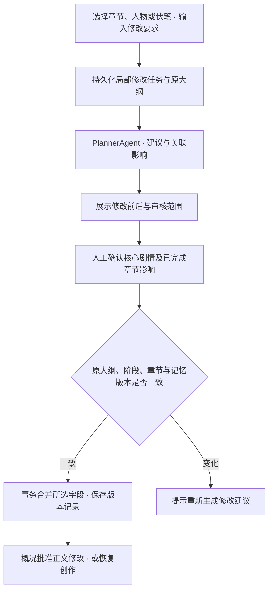

接口：`GET /api/novels/{id}/plan-changes` 查询修改范围与历史；`POST` 同地址提交 `{path,instructions}`；`POST /api/novels/{id}/plan-changes/{changeId}/approve` 提交 `{acknowledgeCore,acknowledgeCompleted}` 确认保存。`POST /api/novels/{id}/approve-plan?useCurrentPlan=true` 批准服务器已保存大纲，正文修改接口 `/revise` 支持 `{instructions,useCurrentPlan:true}`。服务器限定允许修改的字段，禁止改写章节编号或替换整个大纲。H2 启动时创建表，MySQL 使用 Flyway V3 迁移。

## 框架与执行层

AgentScope Java 固定为 `2.0.4`，使用 `agentscope-core`、`agentscope-harness` 与 `agentscope-extensions-model-openai`。该版本支持 Java 17。HTTP 退避重试使用 Resilience4j Retry `2.3.0`，MyBatis Spring Boot Starter 使用 `3.0.5`，Redisson 使用 `3.52.0`。

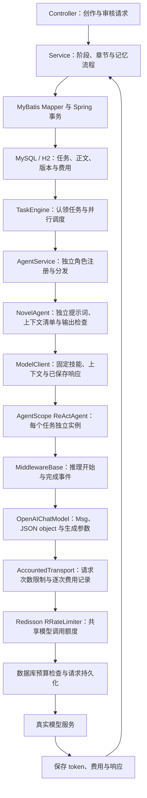

业务 Agent 共6个：选题研究、阶段规划、正文写作、综合审核、记忆整理、创作协调。规划组件处理阶段计划与大纲修改，写作组件处理创作与修改，记忆组件处理提取与人工修正。每次模型任务创建独立执行实例，作品可变状态由版本化业务数据提供。`AgentRuntimeFactory` 构建 `ReActAgent` 和授权 Toolkit，`AgentContextHook` 注入规则并接入 Harness 的 `ConversationCompactor`。工具绑定当前用户、作品和版本；文件未命中返回查询状态，权限与版本错误明确失败。

`OpenAIChatModel` 负责消息格式与生成参数。资料读取默认允许8轮推理和一次最终输出，协调角色默认2轮；`novel.agent-tool-rounds` 支持1至24轮。另预留4次请求供上下文压缩与 HTTP 重试共用，所有真实请求都经过同一额度、限流和费用记录。压缩保留原始任务中的正文、批准目标和输出格式，由框架汇总工具历史；压缩次数受总请求预算约束。工具单次默认24000字节，每次请求的工具空间最多60000字节，并根据当前完整请求剩余空间重新计算。工具查询与压缩不会自动授权正式修改。原始请求、响应、用量与费用保存到 `model_call_turns` 和 `model_calls`；AgentState 使用框架文件存储保存在 `data/agent-sessions`，按用户和任务隔离，结果不确定的外部调用仍需核对。

Resilience4j 对免费服务返回的 HTTP 408、429、502、503、504 最多追加两次请求，等待间隔为1秒、2秒；每次尝试独立记录。付费服务的结果不确定请求保留原有费用核对流程，未知用量保持 null。

MyBatis 负责全部业务数据库访问。`repository/mapper` 中的接口处理任务认领与模型调用状态，`resources/mappers` 按小说、任务、章节、记忆、选题、费用、质量、修改申请和事件组织 SQL；`Store` 使用 `SqlSessionTemplate` 调用命名语句并提供事务入口。Mapper 参数通过 `#{...}` 绑定，业务服务通过命名操作访问数据。CLOB 转换和 Map 字段名称在 MyBatis 配置中统一处理，事务内部查询采用 `STATEMENT` 本地缓存范围。

`ModelCallMapper` 提供费用汇总、预算锁、预留记录、响应检查点、结算和中断恢复等具体方法；`MemoryMapper` 提供版本快照、历史修改基准与记忆写入。`ModelCallReservation`、`ModelCallCheckpoint`、`MemoryEntry` 记录明确的参数与返回字段。费用预留使用 Spring `@Transactional`，调用资料、技能指纹、请求正文和框架版本通过一条 INSERT 保存；同一次预留使用一致的费用月份。模型 HTTP 请求位于费用预留事务之外。其他业务仍使用 `Store` 的命名语句入口。

每次执行在预留前生成独立 `callId`，响应结算和异常状态使用该标识更新所属记录。相同任务的并发预留仍受数据库唯一约束限制，预留失败的一方无法修改另一方的调用状态。

## Agent 输出与上下文处理

任务上下文的 `_workflow.planStatus` 由系统业务状态提供，写作按已批准的章纲执行。规划文字和历史交接中的提案备注不改变审批状态。写作输出使用 `status=GENERATED` 并提供 `title`、`body`；无法生成时使用 `status=BLOCKED` 和 `reason`，该结果在保存草稿前被拒绝。审核的 `Narrative.climax`、`Narrative.combat` 使用 JSON 布尔值，类型校验错误包含具体字段路径和期望类型。

`dto/AgentOutputs` 使用 Java record 声明大纲、正文、检查报告、节奏、修改计划、记忆增量及选题结构。`AgentOutputReader` 使用 Jackson 映射和 Bean Validation 检查字段类型、必填项、嵌套列表、文本长度和取值范围。布尔字段接收 JSON boolean，章节编号接收 JSON integer，文本字段接收 JSON string；字段类型不匹配时明确失败。额外字段继续保存在原始响应中，任务结果仍使用 JSON 提交给工作流。

`PlanValidator` 检查章节数量与连续编号，`ReviewValidator` 检查报告结论及正文原文证据，记忆模块检查事实 key、关系 key 与证据，选题模块检查引用是否来自已采集资料。结构检查和业务校验分别维护，不增加隐式模型重试。

`MemoryService.contextData` 返回上下文对象，`TruthDocumentService` 直接组装按角色选择的资料。一次上下文构建读取一份版本快照，graph 构建和事实排序共用该快照。规划记忆按分类和数量上限收集，每条选中记录的 JSON 内容解析一次。对外保留 JSON 文本入口，内部对象通过 Jackson `valueToTree` 转换，避免字符串生成后再次解析。

启用 Redis 后，`ModelRateLimiter` 使用 Redisson `RRateLimiter` 共享每分钟调用额度，超限任务延后调度。连接中断会明确报告失败；费用与请求状态继续由数据库记录。数据库的60秒调用数量检查同时保留，Redis 清空后仍受已有调用记录约束。Redis 许可在数据库预留前取得，预留失败时许可仍计入当前一分钟，限流结果保持保守。应用当前采用单个进程；连接 MySQL 后，多实例部署仍需要补充执行所有权管理。

框架学习入口：角色的 `tools()` / `runtime()` → `AgentRuntimeFactory` → `AgentScopeExecutor` → `AgentCallAccounting` → `TaskEngine`。`ReviewOrchestrator` 声明审核参与者并进行持久化任务的并行调度与结果汇合；`TaskScheduler` 统一任务唯一键，`WorkflowService` 根据汇合结论推进业务状态。

## 创作协调与多 Agent 协作

在作品概况的“让协调 Agent 分析修改要求”中描述想调整的内容。`CoordinatorAgent` 必须通过 `delegate_draft`、`delegate_outline` 或 `delegate_memory` 工具选择一个处理角色，输出处理范围、修改要求和理由。工具调用仅记录委派建议；人工点击“确认交给所选 Agent”后，后端检查大纲、正文修订号、阶段与记忆版本，事务创建对应的持久化任务并保存父任务与委派任务的关联。重复确认不会创建重复任务，修改内容已经变化时需要重新分析。

正文委派进入现有修改与复审流程；大纲委派生成待确认的局部修改建议；记忆委派仅在存在待处理记忆审核时进入记忆修正流程。各角色使用自己的 Toolkit 和任务上下文，正式正文、大纲和记忆由业务审批流程提交。Agent 看板可展开各角色的工具权限与推理轮数，执行详情展示每次模型请求，调用次数按 HTTP 请求统计，费用只汇总一次。

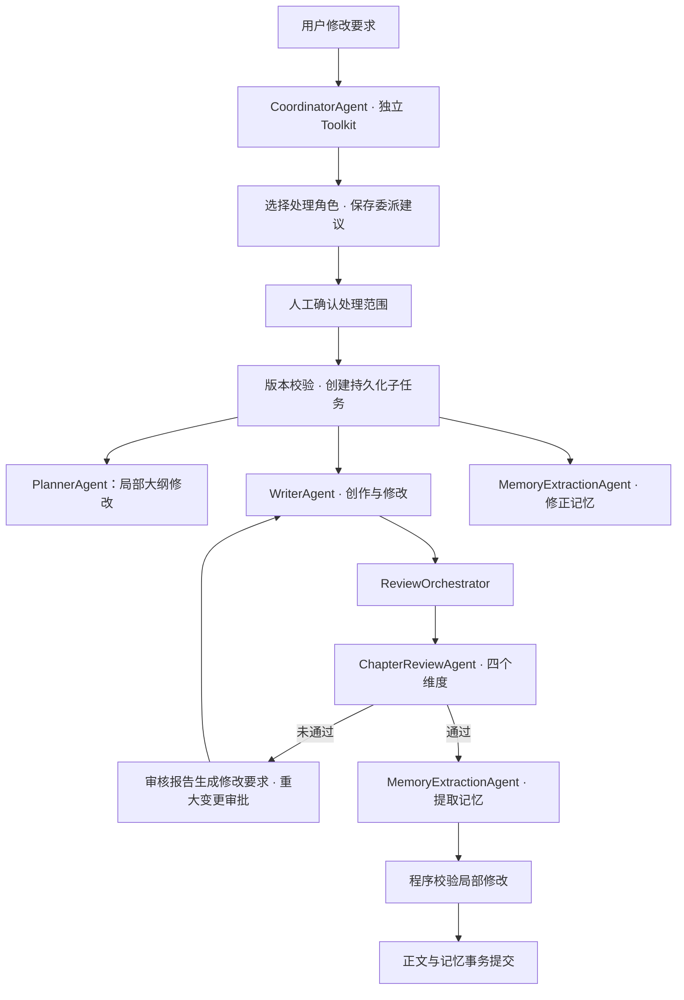

默认使用联合审核；已创建的历史审核轮次保留其参与操作集合。接口：`GET /api/novels/{id}/coordination` 查看协调记录，`POST` 同地址提交 `{instructions}`，`POST /api/novels/{id}/coordination/{taskId}/approve` 确认委派。MySQL 使用 Flyway V4 创建逐次请求记录，H2 启动时自动创建。

协调入口按用户提交的修改要求执行，正常逐章连载继续由状态机推进。真实 `deepseek-flash` 验证中，协调 Agent 使用委派工具，经过2次请求形成建议；人工确认后，大纲修改 Agent 通过1次请求形成待审核建议。该成功链路估算费用0.090744元，模型请求的输入、输出 token 合计与任务汇总一致；复用完整检查点没有增加模型请求。120项检查和真实 Edge 页面操作通过，包括14项 MySQL 验证。实际平台账单仍按供应商记录核对。

## 固定加载写作技能

项目固定使用 [fanqie-novel-skill](src/main/resources/skills/fanqie-novel-skill/SKILL.md) `v2.0.1`，作者 Jayce，来源为 `304769384-png/fanqie-novel-skill`，提交 `7d874e032d2de3dace74ae585cd2dbfbac2cde69`。上游文件原文随项目保存，来源及 SHA-256 记录在 [origin.properties](src/main/resources/skills/fanqie-novel-skill/origin.properties)。

技能主文件及角色参考资料在组件初始化和快照构建时读取、校验并保存来源指纹，角色族复用不可变快照。`runtime-rules.md` 提供应用维护的运行指令，来源原文继续完整保留。模型调用与结果恢复记录技能版本、来源文件清单、来源及运行规则指纹和实际请求正文；章节周期要求通过任务资料提供。API key 通过请求头发送，独立保存在本机配置中。

项目开发的固定读取规则写入 [AGENTS.md](AGENTS.md)。运行时通过 `SkillService` 加载技能，将写作规则、检查规则和数据库中的 Truth Files 提供给各角色。平台政策和收益依据经核实的官方资料判断；技能中的写作建议用于创作和检查。

## 创作工作流

一部小说由连续的故事阶段组成，每个阶段默认10章，创建作品时可以设置为1至20章。阶段审核通过后继续规划下一阶段，整部小说不预设完结章数。人工审核、费用额度及电脑运行状态决定任务何时继续。

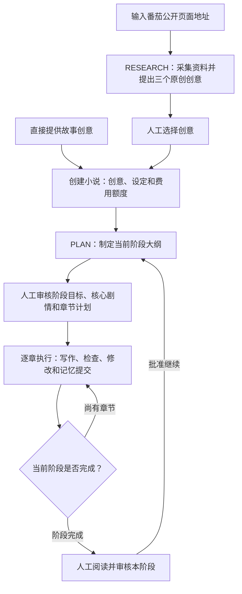

选题研究可以填写自己的想法，包括题材、人设、读者期待、情节要求和不希望出现的内容；参考链接可选，最多提供五个番茄公开页面。想法或链接至少填写一项。提供链接时使用 Jsoup 读取，保存 URL、标题、采集时间和文字摘录；仅提供想法时进行原创构思，报告明确说明资料范围。

每份报告提供三个完整方案。报告下方支持持续讨论，例如调整主角职业、加强悬疑或比较方案；Agent 直接回应意见，并更新三个方案。用户与 Agent 的交流、每轮方案和调用记录持久化保存，可以查看历史并选择当前方案创建作品。每份报告同时执行一轮讨论，任务失败时沿用已有费用核对与人工重新执行流程。

讨论输入包含最初想法、当前三个方案、已采集资料和最近12条交流；全部交流历史继续保存在数据库。网页定期更新任务进度，并保留尚未发送的输入。界面使用亮色主题，桌面采用想法输入与方案讨论的双栏布局，手机宽度下顺序展示。

阶段大纲包含 `stageGoal`、`coreMilestones`，以及每章的编号、标题、目标、出场人物和关联伏笔。人工可以按字段生成局部修改建议并确认保存，批准已保存大纲后开始正文生成。

## 每章执行流程

每章使用批准的章节计划生成正文，综合审核返回四个维度的结论和可执行修改要求。正文通过后提取记忆局部修改，由程序核对版本、原文、格式、标识和证据路径，随后提交章节和正式记忆。

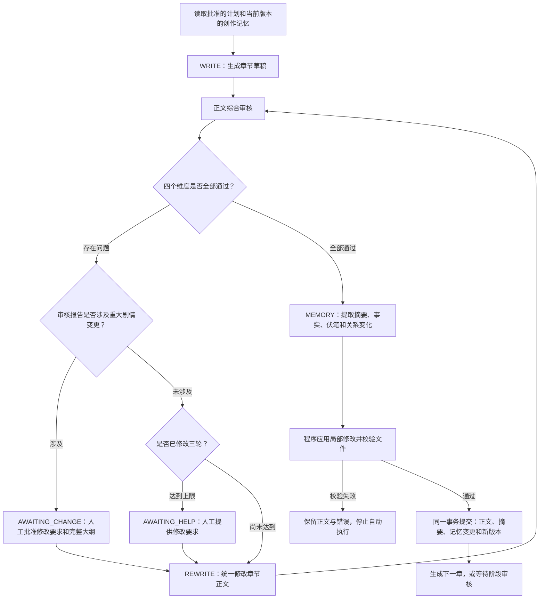

| 任务 | 负责内容 | 输出 |
| --- | --- | --- |
| `RESEARCH` / `RESEARCH_CHAT` | 依据个人想法和可选资料提出、讨论原创选题 | 回复、三个完整创意及来源 |
| `PLAN` | 阶段冲突、剧情节点和章节安排 | 阶段大纲 |
| `WRITE` / `REWRITE` | 生成或统一修改章节 | 标题、正文 |
| `CHECK_CHAPTER` | 联合检查人物、剧情、节奏与文风 | 四个维度结论、问题归属、原文证据、叙事结构和篇幅建议 |
| `MEMORY` | 提取本章必要变化 | 摘要与 Markdown 局部修改 |
| `MEMORY_REPAIR` | 按人工要求修正记忆 | 与提取操作相同的局部修改 |
| `CHECK_MEMORY` | 兼容已有候选及人工编辑，执行本地校验 | 校验后的文件，不调用模型 |

每个角色由独立任务、提示词及结构化输入输出定义，任务在同一 Java 应用中执行。检查角色提交报告，正文由写作角色统一修改，记忆由流程模块统一提交。

## 独立 Agent 与信息范围

系统采用6个业务 Agent 组件：ResearchAgent、PlannerAgent、WriterAgent、ChapterReviewAgent、MemoryExtractionAgent、CoordinatorAgent。规划与局部大纲修改共用 PlannerAgent；记忆提取与人工修正共用 MemoryExtractionAgent。`AgentService` 在启动时检查组件数量、任务类型重复和遗漏。`GET /api/agents` 按组件返回目录，`kinds` 列出操作；历史任务和费用保留。

默认 `novel.review-mode=combined`，正文一次调用检查四个维度，每条问题标明 `dimension`，各维度与总体结论必须一致，程序统计继续保存。每章一次通过时包含正文创作、正文审核、记忆提取3次主要调用；工具查询、压缩、HTTP 重试及正文修改另行计数。记忆提取使用当前状态、交接、目录与本章正文，其他主题按需读取。

综合审核逐项输出人物、剧情、节奏、文风结论。程序验证记忆修改的结构、版本、唯一原文匹配、来源路径、链接和标识；引用存在不代表语义必然正确，仍需通过正文质量检查和人工阅读评价内容。测量方法见 [Agent 审核评估](docs/agent-review-evaluation.md)。

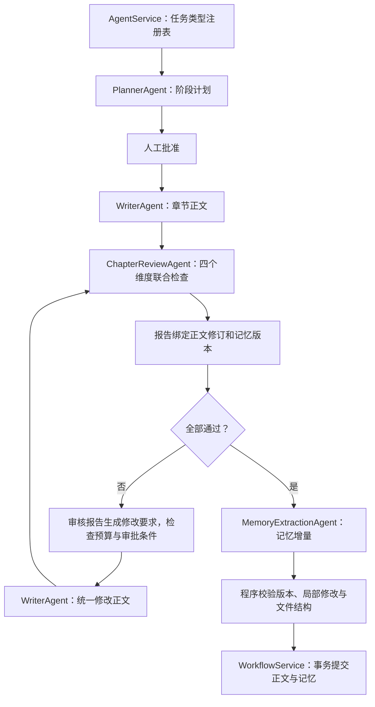

角色组件保持无会话状态，每次任务创建独立的 AgentScope `ReActAgent`。`AgentContextService` 根据角色声明的资料清单提供输入，并校验当前记忆版本、正文修订。正式记忆使用版本化 Markdown 文件，数据库保存发布清单与指纹；角色通过任务结果协作。

| Agent | 额外输入范围 |
| --- | --- |
| PlannerAgent | 创作设定、历史计划、规划记忆、最近八章摘要、修改要求 |
| WriterAgent | 基础故事资料、人物关系、知情范围、文风与对话要求；修改操作增加原正文和修改计划 |
| ChapterReviewAgent | 人物、剧情、节奏与文风资料的并集，正文和统计只提供一次 |
| MemoryExtractionAgent | 当前状态、交接、记忆目录及本章正文；需要更新的主题按需读取 |
| ResearchAgent | 用户想法、已采集资料、当前方案与最近交流 |

基础故事资料包含设定、大纲、当前状态、待处理伏笔、交接记录和审核规则。规划输入单独组装，提供规划需要的分层记忆。只有节奏与文风等需要质量记录的角色读取相应统计。

`GET /api/agents` 提供任务类型、组件名称、职责和上下文清单。`GET /api/agents/metrics` 按角色任务类型统计完成、失败、等待、取消、调用次数、输入输出 token、已结算费用、待结算预留和不确定调用，支持 `?novelId=作品ID`。统计覆盖数据库保留的全部历史记录；历史取消任务保留在统计中。`AGENT_STARTED` 事件记录组件名称、任务类型、正文修订、记忆版本和上下文清单，用于关联任务、模型调用及检查结果。

线程池由 Spring `ThreadPoolTaskExecutor` 管理，默认4个工作线程，线程及队列都有明确上限，关闭时按模型调用超时等待任务完成。持久化调度、四份报告汇总、人工审核和正式记忆提交由业务流程负责。

检查报告需要引用当前正文中至少4个字符的原文。程序校验证据是否存在、结论与问题列表是否一致；模型负责评价语义和阅读节奏。正文参考篇幅为2000至2500个非空白字符，完整结果先保存为草稿，再进入独立检查与整理流程。字数单独记录在文风检查结果的 `lengthAdvice` 中，包含实际字符数、参考范围与整理建议；字数差异本身不阻止草稿保存或触发修改。内容缺失、重复、因果与节奏等具体问题继续由检查、分析和修改流程处理，对话比例规则保持有效。整理过程中保留关键人物动作、物证和已通过检查的内容。

对话占比按含引号的非空行数除以全部非空行数计算，超过40%进入修改流程。节奏检查记录开头、主要活动、结尾、冲突解决方式、叙事模式、高潮及战斗标记。每五章结合此前四章回顾叙事模式，每十章结合此前九章摘要和质量记录按完整维度回顾。

自动修改最多三轮，且始终受费用额度限制。修改涉及核心剧情、人物重要转变、关键伏笔答案或阶段结局时等待人工批准。人工批准后可以明确发起新的修改轮次。记忆检查失败也进入人工处理，批准修改后重新执行正文检查及记忆提取。

## 持续连载的上下文与记忆

正式记忆保存为 Markdown 主题文件。每次任务读取短入口、当前状态和交接，按章节目标加载相关人物与伏笔，再通过目录、关键词搜索和分页读取补充历史资料。完整正文及其 revision 继续由数据库管理。

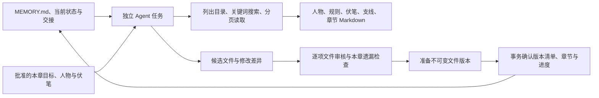

### 记忆保存

| 数据 | 保存方式 | 用途 |
| --- | --- | --- |
| 当前正文 | `chapters` | 阅读、检查和导出 |
| 正文修改历史 | `chapter_history` | 保留被替换的正文版本 |
| 主题记忆与来源 | `data/books/<novelId>/memory/versions/` 中的 Markdown | 文件搜索、阅读与导出 |
| 候选修改 | 数据库中的任务结果及模型响应 | 修改预览、审核与恢复 |
| 发布清单与文件指纹 | `memory_file_versions`、`memory_files` | 固定任务版本，解析逻辑路径 |
| 阶段大纲 | `novels.plan` | 控制当前阶段剧情 |
| 任务和调用记录 | `tasks`、`model_calls`、`events` | 恢复执行、核对费用和追踪问题 |

文件包含 YAML front matter：`id`、`type`、`name`、`aliases`，正文使用 Markdown 标题与自然语言。人物文件分别记录稳定特征、当前状态、关系和知情范围；伏笔、规则、支线和阶段记录分别保存。稳定标识持续沿用，正文来源保留章节、revision 与片段标识。

`MEMORY.md` 是短导航，人物、伏笔等目录在各自 `INDEX.md` 中维护。目录允许分页。新版本仅保存变化文件，完整清单引用其他版本中未变化的不可变文件，读取时无需逐个追溯版本链。数据库不再独立修改另一份事实正文。

已有 `memories` 记录在首次访问所需版本时迁移到文件，原表保留作为迁移来源。历史附录保留原 key、内容和证据，迁移本身不宣称完成语义复核。兼容接口与 TinkerGraph 支持历史结构记录；新的人物关系和知情范围通过 Markdown 人物文件读取。

### 本章上下文选择

- 每次加载短入口，并按角色提供当前状态、交接、批准的大纲与质量记录。
- 本章明确匹配的人物或伏笔主题直接加载；同名历史记录提供有限入口并要求继续核查。
- 人物与伏笔目录、章节摘要和历史证据按需读取，不在初始请求中拼接全书资料。
- `ContextBudget` 为固定技能、必需正文、任务资料和请求包装预留空间。初始资料优先使用可用空间，工具历史按每次实际请求的剩余空间限制。必需文件超过预算时明确失败，不截断文件尾部。
- 完整请求继续受120000字节限制，包括所有工具消息；每次请求记录实际大小和返回用量。

`list_memory_files(directory, offset, limit)` 返回路径、标题、说明与指纹；`search_memory(query, directory, offset, limit)` 返回有限命中上下文；`read_memory(path, offset, length)` 返回正文范围、指纹、下一位置和未读取标记，位置按 Unicode code point 计算。`read_candidate_memory` 读取当前待审文件，`read_source` 按章节、revision 与片段读取原始证据。所有工具受用户、作品、任务版本和目录限制。

工具默认单次最多24000字节，当前请求的结果空间最多60000字节，运行时根据完整请求重新计算；预算包含序列化转义与 `_toolBudget` 信息。通过 `NOVEL_TOOL_RESULT_BYTES`、`NOVEL_TOOL_TOTAL_BYTES` 配置。单文件默认读取6000个 Unicode code point，可指定1至12000；目录默认15项、最多30项，搜索默认10项、最多20项。空间不足时工具返回 `BUDGET_EXHAUSTED`，后续模型请求由上下文 hook 判断是否需要压缩。

`lookup_memory(entity)` 按稳定标识或名称返回真实文件路径，状态为 `FOUND`、`NOT_FOUND` 或 `AMBIGUOUS`。单文件与候选读取分别标记 `scope=published/candidate`，缺失时返回 `NOT_FOUND`；查询未命中不证明故事事实不存在。格式、权限、版本及文件损坏仍明确报错。

已有候选仍可通过 `read_candidate_memory` 查看。正式文件在事务提交前保持原有版本。

记忆提取或修正任务重试时，任务资料包含 `retryFailure`，提供上次失败的校验信息。新主题使用独立文件标识，历史来源的标识与路径保持只读；关系文件的主题标识与关系块的 `subject`、`predicate`、`object` 分别维护。标识冲突会明确指出已有文件及其编辑限制。

### 上下文压缩与提示缓存

`AgentContextHook` 在模型调用前排序工具定义，按配置 token 容量和请求大小判断是否需要压缩；token 数由 AgentScope `TokenCounterUtil` 估算，实际费用始终使用服务返回用量。`NOVEL_MODEL_CONTEXT_TOKENS` 默认32768，特定模型可以配置 `novel.context-models.<model>.tokens`；输出额度和2048 token 包装空间另行预留。120000字节继续作为应用请求保护上限。

达到请求估算大小的75%或输入 token 预算的80%时，使用框架 `ConversationCompactor` 总结工具历史并保留原始任务。系统规则保留，摘要记录任务目标、输出字段、已确认事实、来源与待办；压缩请求共用任务请求预算，并记录费用和限流。无法找到可压缩历史、压缩失败或压缩后必需资料仍超过容量时明确报告；原文继续保存在正式记忆与请求记录中。

规则通过 `onSystemPrompt` hook 注入一次，技能快照按角色族复用，动态章节资料位于后续用户消息；JSON 对象字段和工具顺序固定。`PROMPT_PREFIX_READY` 记录前缀指纹，供应商返回的缓存 token 与命中率显示在用量日志。实际缓存命中由供应商决定，前缀复用不代表已经命中。支持该字段的服务可通过 `NOVEL_PROMPT_CACHE_KEY_ENABLED=true` 发送按用户、供应商、模型和规则生成的 `prompt_cache_key`，默认关闭以兼容本地代理。

`read_memory_batch(paths, offset, length)` 支持最多30个不同路径，顺序表示读取优先级。一次读取版本清单，在共同预算内返回存在的文件原文、指纹、已读范围、`nextOffset` 和 `hasMore`。`missingPaths` 列出当前版本不存在的路径，Agent 可以查询目录或搜索确认；`pendingPaths` 列出尚未读取的已有文件。单个文件可以使用 `read_memory` 从继续位置获取后续内容。分页按实际字节计算能够容纳的字符数，保持 Unicode 完整。

本章人物和伏笔通过稳定标识、名称及 YAML 别名匹配。明确的当前主题在初始预算内自动提供；同名或别名冲突保留候选，历史来源按本章条目提供路径、指纹和章节，供模型直接批量读取。本章主题预算通过 `novel.memory-initial-topic-bytes` 配置，默认16000字节。`_loadedMemory` 显示已经完整提供的文件及范围，模型据此减少重复读取。别名由 YAML 库解析，派生别名缓存使用文件指纹作为键并限制容量；正式记忆继续由已发布文件版本提供。

### 记忆局部修改与校验

模型返回本章必要的 `patches`，程序根据正式版本生成完整候选用于校验、差异记录和事务提交。已有主题的其余内容保持原文，记忆提取不预加载整批人物与伏笔全文，需要修改时按路径读取。历史候选可用于查看与人工处理，正式版本在提交前保持原有内容。

工具的目录、搜索、单文件与批量文件结果通过 `editPolicy` 说明内容用途：`historical-source` 为只读迁移来源，`generated` 为程序维护的目录和章节记录，`current-topic` 为可提交修改的当前主题。历史来源中的 `memory-record` 附录用于核对事实，由程序保留；整理和修正应更新当前主题，新主题使用独立的稳定 `id` 和 `path`，保留来源链接及原始章节。历史文件不参与修改列表，后台在版本校验时禁止覆盖；候选内容包含历史附录时会指出具体文件及整理要求。

记忆整理输出 `summary` 与 `files`。每项文件修改包含 `path`、`expectedHash`、完整 Markdown `content`、变化 `description` 和本章 `evidencePaths`。旧文件必须沿用读取时的指纹和稳定标识，新文件指纹为空；每章更新 `current_state.md` 与 `handoff_current.md`。目录和本章记录由程序生成。

单个主题文件默认最多16000个 UTF-8 字节，两个常驻短文件分别最多6000字节。参数为 `novel.memory-file-bytes` 和 `novel.memory-entry-bytes`。大文件应按照有意义的主题组织，并通过目录继续访问历史。

记忆提取输出 `patches`：每项含 `path`、`expectedHash`、`edits[{oldText,newText}]`、`description` 和 `evidencePaths`。已有主题不输出完整文件；各项原文必须唯一匹配且互不重叠，程序逆序应用修改并逐字保留其他内容。新主题使用完整 `content` 和空 `edits`。每章最多12个文件、每文件12处修改、总输出32000字节；普通主题的单处原文最多2048字节。当前状态与交接各最多6000字节。校验失败保留正式版本并报告具体错误；不自动启动记忆修正循环。重大剧情变更、阶段审批和费用额度继续执行。

全部通过后，在数据库事务外准备并持久化不可变文件，再在同一事务中登记文件清单、确认章节与摘要、切换 `memory_version`、推进进度并创建下一任务。正文 revision、基准版本或候选指纹发生变化时拒绝提交。准备完成但尚未发布的文件不对任务可见，发布版本中的未修改文件继续共享原文件。

程序启动时校验已发布文件的长度和指纹；文件缺失或损坏的作品进入错误状态。备份和迁移需要同时保存业务数据库与 `novel.memory-directory`，该目录默认 `./data/books`，可以通过 `NOVEL_MEMORY_DIRECTORY` 指定。

人工入口继续使用 `GET /api/novels/{id}/memory-review` 和 `POST /api/novels/{id}/memory-repair`。页面可以直接编辑待审核的 Markdown；正文与大纲保持原版本。文件问题使用 `quoteSource=MEMORY`、`quotePath=/files/0/content`，可以提供相关的连续 `quote`，程序核对原文；正文证据通过 `/paragraphs/p0` 定位。历史结构输入保留兼容检查。

### Truth Files 与质量记录

当前状态、交接和主题资料从正式文件版本读取，大纲与质量统计由批准的业务数据生成；技能所需的伏笔、人物关系与知情资料导航到对应主题。任务无需等待用户重复提供交接文件。

网页“创作记忆”支持目录分页、关键词搜索和范围读取；“交接资料”支持完整 ZIP 导出。接口为 `GET /api/novels/{id}/memory-files`、`/memory-files/search` 和 `/memory-files/content`，可以指定正式历史版本。历史修改后的质量记录只统计仍然有效的正文版本。

## 多任务并发与持久化编排

`TaskEngine` 每500毫秒检查可执行任务，默认使用4个工作线程。多部小说可以并发推进，同一部小说按章节依赖执行；草稿完成后默认登记一次综合审核任务。

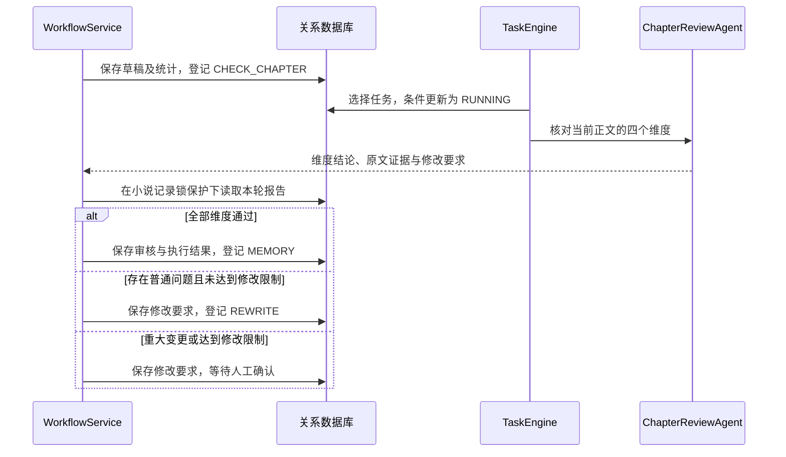

实际并发数量取决于空闲工作线程和调用限额。选择任务时优先考虑当前执行任务较少的作品，再根据任务时间排序。

任务记录包含作品、任务类型、章节、修改轮次、记忆版本、输入、输出和错误。`task_key` 由作品、阶段、章节、修改轮次、记忆版本和任务类型组成，数据库唯一约束与应用检查共同防止重复登记同一步骤。

流程结果提交时锁定对应小说记录，核对正文、记忆和任务版本，再登记下一步任务。影响同一小说进度的状态提交受数据库事务保护。详细职责、记忆审核阶段和运行 hook 见 [小说 Agent 流程与职责](docs/multi-agent-workflow.md)。

### 费用与速率限制

每次调用先检查上下文字节数，再在预算记录锁保护下检查速率和相应额度、预留费用，随后请求所选模型。

模型服务支持 `metered` 与 `unmetered`。计费服务使用原有人民币预算规则；免费服务的预留和实际费用为零，保留输入、输出 token 及完整调用记录。历史费用持续保留，计费额度用尽时仍可使用免费服务；全部服务共享调用速率限制。

| 配置 | 默认值 | 范围 |
| --- | --- | --- |
| `novel.workers` | 4 | 全部作品共享的工作线程数量 |
| `novel.model.requests-per-minute` | 30 | 全部模型调用共享的滚动60秒限额 |
| `novel.monthly-budget` | 300元 | 按北京时间月份统计的总额度 |
| 作品月额度 | 100元 | 创建作品时设置 |
| 章节调用额度 | 5元 | 创建作品时设置，累计该章节全部任务费用 |

速率达到上限时，任务延后5秒重新等待调度。费用额度不足时，该作品进入 `BUDGET_PAUSED`，已有进度保留。供应商返回 token 用量后，按配置的人民币单价结算，并保存本次调用使用的模型和单价。

阶段规划任务也带有章节编号，其费用计入对应章节额度。输入费用预留依据消息字节数估算；实际费用超过预留金额时，任务停止并要求核查供应商单价及 token 规则。

默认流程一次通过时，写作、综合审核和记忆提取共三次主要模型调用。工具查询、上下文压缩、重试、阶段规划和正文修改另行计费；所有请求都计入额度与用量记录。实际 token 节省需要真实章节对比，不能用主要调用数量直接推算。

### 暂停、失败与重启恢复

- **主动暂停**：停止继续推进该作品；已发出的调用仍可能完成和计费。结果保存为 `READY`，恢复后继续处理。
- **任务失败**：任务进入 `ERROR`，所属小说暂停；其他作品继续执行。人工可以明确重新执行失败任务。
- **重启恢复**：此前处于 `RUNNING` 且没有结果不确定调用的任务重新进入等待调度。已保存的任务结果或 `COMPLETE` 模型响应可以复用。
- **调用结果不确定**：此前处于 `IN_FLIGHT` 的调用转为 `UNCERTAIN`，保留费用预留。人工在供应商后台核对实际费用后，才能明确重新执行关联任务。

## 历史章节修改

当前影响分析保守包含修改章节及全部后续章节，同时列出来源章节位于该范围内的当前记忆。批准操作会使受影响正文等待重新生成。

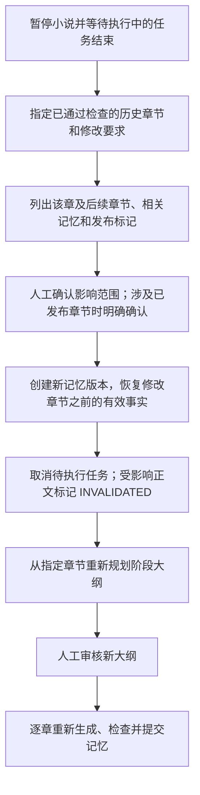

历史记忆版本保留，正文被替换前保存到 `chapter_history`。修改请求记录创建时的记忆版本；批准时若版本已变化，需要重新分析影响范围。结果不确定的调用需要完成费用核对后才能批准历史修改。

## 启动与配置

模型单次 HTTP 等待时间由 `novel.model.timeout-seconds` 配置，默认180秒。`novel.model.role-timeout-seconds` 按角色覆盖：`memory`、`memory_repair` 默认600秒，`check_memory` 默认300秒。角色键使用任务类型的小写形式。SDK 的请求截止时间比 HTTP 多15秒，整个 Agent 的截止时间按允许请求次数计算；模型请求仍只执行一次尝试。

每次请求开始的日志与事件记录当前单次等待上限。模型异常会保留原始原因并终止任务，SDK 的错误说明文本不能成为正式结果。尚未取得响应的调用保留 `UNCERTAIN` 状态和待核对费用，已完成轮次的用量继续保存；调用记录的 `usage_json` 分别记录已知输入、输出用量及未完成请求数量。

运行环境需要 Java 17 或更高版本。项目自带 Maven Wrapper；当前 `start.ps1` 使用本机路径 `C:\Program Files\Java\jdk-17`，其他电脑需要调整脚本中的 `JAVA_HOME`。

在 PowerShell 中执行：

```powershell
Set-Location 'D:\java_learning\novel-agent'
Copy-Item -LiteralPath 'config\application-local.example.yml' -Destination 'config\application-local.yml'
```

编辑 `config/application-local.yml`，填写供应商配置。该文件只保存在本机。现有计费服务沿用以下配置：

| 字段 | 内容 |
| --- | --- |
| `novel.model.endpoint` | `/v1` 基础地址或完整 Chat Completions 地址；远程使用 HTTPS，本机允许 HTTP |
| `novel.model.api-key` | API key |
| `novel.model.name` | 模型名称 |
| `novel.model.input-per-million` | 每百万输入 token 的人民币价格，必须大于零 |
| `novel.model.output-per-million` | 每百万输出 token 的人民币价格，必须大于零 |
| `novel.model.billing-mode` | `metered` 表示按 token 计费 |

多个服务配置在 `novel.providers.<id>` 下，每个服务包含 `display-name`、`endpoint`、`api-key`、`name` 和 `billing-mode`。计费服务还需设置 `input-per-million`、`output-per-million`；免费服务设置 `billing-mode: unmetered`。`novel.default-provider` 指定新作品和选题研究使用的默认服务，`default` 指向原有 `novel.model` 配置。

前端创建作品和作品概况页面提供服务、模型下拉选项，模型列表从所选服务读取。服务地址及 API key 保存在服务端本机配置，接口只提供名称和计费方式。作品创作中可暂停并等待当前任务结束后切换；等待人工审核或处理失败时也可以切换。选择仅影响后续模型调用，已保存结果与费用记录继续保留。未指定具体模型时使用服务默认模型；原有服务继续支持按角色配置。

模型需要支持 `response_format: json_object`、`max_tokens`，并返回 `usage.prompt_tokens`、`usage.completion_tokens`。也可以使用 `NOVEL_MODEL_ENDPOINT`、`NOVEL_MODEL_API_KEY`、`NOVEL_MODEL_NAME`、`NOVEL_INPUT_PRICE`、`NOVEL_OUTPUT_PRICE` 环境变量。`novel.agents` 下可以按角色分别配置模型名称、地址、密钥及价格；未单独配置的字段使用 `novel.model` 中的值。

选题研究表单和每份报告的讨论输入框也提供“模型服务”“文本模型”选项。初次研究使用所选服务和模型；讨论默认沿用该报告最近保存的选择，也可以在发送前切换。新任务保存明确的 provider 和 model_name，恢复与人工重新执行继续使用该任务的选择，费用记录保留每次实际调用的信息。历史报告可从已有调用记录读取模型信息。

模型列表正在读取、服务尚未配置或列表读取失败时，选题提交按钮保持禁用；讨论已有待处理任务时，模型选择与发送按钮禁用。页面自动更新会保留当前选择。升级后需要重启后端并刷新页面；前端检查后端是否支持选题模型选择，确认支持后开放提交。API key 和服务地址继续保存在本机配置中。

模型列表读取失败时，页面显示对应服务与具体原因，并提供“重新读取模型列表”按钮；重新读取保持当前服务选择。连接失败返回502、请求超时返回504，请求中断返回503；鉴权与上游响应错误也通过结构化错误说明。日志记录服务标识和错误类别，凭据及响应正文保留在输出范围之外。本地服务需要启动后才能读取其模型列表。

```powershell
.\start.ps1
```

脚本默认启用 Redisson，并使用 `start-redis.ps1` 检查或启动本机 Redis。连接检查未成功时，脚本启动 Redis 并等待连接就绪。当前 Redis 程序目录为 `D:\Program Files\Redis-x64-5.0.14.1`，只监听 `127.0.0.1:6379`，项目数据保存在 `data/redis`。已经运行的 Redis 会继续使用。脚本随后构建项目，将 JAR 复制到独立的运行目录，以 `local` profile 启动。访问 [本地创作工作台](http://127.0.0.1:8096)。服务默认仅监听本机地址。

IDEA 的 Run Configuration 使用 Java 17，启用 `local` profile，并设置环境变量 `NOVEL_REDIS_ENABLED=true`。可以单独执行 `.\start-redis.ps1` 启动 Redis。外部 Redis 通过 `NOVEL_REDIS_ADDRESS`、`NOVEL_REDIS_PASSWORD` 配置，使用独立 key 范围时设置 `NOVEL_REDIS_PREFIX`。这些选项也可以保存在本机配置的 `novel.redis` 下。配置启用 Redis 后，连接失败会阻止启动或模型调用。

直接启动 Java 应用时，`novel.redis.enabled` 默认 `false`，使用数据库调用数量限制；启用后叠加 Redisson 共享限流。`/api/status` 返回 `agentFramework`、`persistence` 与 `rateLimiter`，方便确认当前配置。

Redis 限流使用 `<key-prefix>:model:requests:v2` 保存持久化配置，每次申请额度前通过 `trySetRate` 幂等初始化并核对额度、时间间隔和类型。已有配置和已消耗额度会继续使用；Redis 重启后配置缺失时按需建立，数据库调用次数限制继续生效。旧限流键保留原有过期行为，版本化名称使当前配置具有独立的生命周期。

网页操作顺序：选题研究或直接创建作品 → 阶段大纲审核 → 查看章节和执行记录 → 处理修改或费用待办 → 阶段阅读审核 → 继续下一阶段。正文可以导出为文本文件，发布及平台正文修改由人工完成。

未指定 MySQL profile 时，数据库位于 `data/novel`。`data/`、`target/`、`.work/`、日志、`.env`、`config/application-local.yml` 和 `config/mysql-local.properties` 已加入 Git 忽略规则。

### 本机 Neo4j

本机安装 Neo4j Community 5.26.32（5.26 LTS），使用已有 Java 17。安装目录为 `D:\Program Files\Neo4j\neo4j-community-5.26.32`，配置为该目录中的 `conf\neo4j.conf`。数据与日志分别保存到 `D:\ProgramData\Neo4j\data`、`D:\ProgramData\Neo4j\logs`，仅监听本机。初始 heap 为256MB，最大512MB，page cache 为256MB。

Browser 地址为 [Neo4j Browser](http://127.0.0.1:7474/browser/)，Bolt 为 `bolt://127.0.0.1:7687`，默认数据库与账号均为 `neo4j`。密码和连接信息保存在 Git 忽略的 `config/neo4j-local.json`，不包含在仓库与全局环境记录中。

当前使用隐藏的后台进程运行，未注册 Windows 服务或配置开机启动。进程结束后，可在项目目录执行 `.\start-neo4j.ps1`，该脚本检查安装目录、Java 和监听端口，并将标准输出与错误保存到 Neo4j 日志目录。脚本等待 HTTP 和 Bolt 接口就绪；已有可用服务时直接完成。

IDEA 后端配置和 `start.ps1` 默认启用 Neo4j。直接启动 Java 时，通过 `NOVEL_NEO4J_ENABLED=true` 启用；`NOVEL_NEO4J_CONFIG` 指定连接 JSON，字段为 `uri`、`database`、`username`、`password`。样例见 `config/neo4j-local.example.json`。`NOVEL_NEO4J_NAMESPACE` 指定实例命名空间。连接失败会阻止应用启动；`/api/status` 的 `graphDatabase` 返回 `neo4j` 或 `tinkergraph`。明确关闭时使用进程内查询。

正式记忆内容保存在 Markdown。人物和关系文件可以包含 `story-relations` 代码围栏，内容为 JSON 数组，字段为 `subject`、`predicate`、`object`、`detail`、`evidence`、`deleted`。关系文件由记忆 Agent 生成并经过文件审核，每条关系集中维护，解除关系设置 `deleted=true`。普通叙述不会自动推断成关系；旧 `memory-record` 关系附录继续支持查询。

关系查询按实例、用户、作品和记忆版本隔离。某个版本首次查询时，从已发布 Markdown 建立不可变 Neo4j 投影；关系和完成标记在一个 Neo4j 事务内提交。后续查询通过一次 Cypher 请求执行1至3层关系遍历，保留原有 Redis 查询缓存。新版本按需建立独立投影，历史查询保留原有状态；历史修改产生的新记忆版本按同样方式处理。每个被查询的版本保存一份关系投影，历史关系很多时需要相应的图数据库存储空间。

Neo4j 服务使用共享 Driver 和连接池，每次查询使用独立 Session，固定数据库并使用参数化查询；节点具有唯一约束。图数据库用于人物关系遍历，Markdown 文件搜索继续使用现有文件工具。真实 Neo4j 检查通过环境变量 `NOVEL_NEO4J_TEST=true` 启用，测试使用独立 namespace 并清理自己的图数据。

### MySQL 与已有数据迁移

MySQL 账户与连接地址保存在忽略文件 `config/mysql-local.properties`，样例为 `config/mysql-local.example.properties`。业务数据库使用独立的 `novel_agent`，字符集为 utf8mb4，文本比较区分大小写。连接使用 `connectionTimeZone=%2B08:00` 并同步设置 session 时区，对应北京时间；该配置不依赖服务器的命名时区表。`mysql` profile 使用 Connector/J、HikariCP 和 Flyway，MyBatis 根据 JDBC 数据库类型选择对应 SQL；H2 SQL 初始化继续适用于已有运行方式。数据库类型也通过 `/api/status` 和观测看板返回。[MyBatis databaseIdProvider 说明](https://mybatis.org/mybatis-3/configuration.html#databaseIdProvider)描述了同名 SQL 按数据库选择的机制。

迁移前需要让 H2 源数据库通过当前版本启动完成 schema 升级，随后结束应用写入，保留关闭后的 `data/novel.mv.db` 备份。目标 MySQL 业务表需要为空，包括账号表；迁移前不要使用该目标启动应用。以下命令为迁移操作说明，实际作品迁移尚未执行：

```powershell
.\migrate-mysql.ps1
```

脚本发现应用端口仍在监听时直接终止。编译后调用 `dev.novel.tools.MigrateH2ToMySql`，工具使用只读 H2 连接，源文件被其他进程占用时终止；使用 Flyway 创建 MySQL 表，目标业务表已有数据时终止。工具逐表复制16张业务表，包括账号归属、逐次模型请求与大纲修改记录，保留任务、章节、记忆版本、费用、事件与评价编号，核对每张表的记录数量后在同一事务中提交数据。预算锁由建表迁移初始化。源文件保持只读，工具不切换或重启应用。独立数据库验证覆盖新增业务表、账号内容、非空目标拒绝及连接关闭后的失败撤销；实际作品的完整迁移尚未执行。

完成迁移后的启动方式为 `.\start.ps1 -Database mysql`；IDEA 配置启用 `local,mysql` profiles，工作目录设置为项目目录。默认启动方式继续读取 H2，防止已有数据尚未迁移时进入空数据库。切换 MySQL 后不应继续向 H2 写入新业务数据。

Redis 配置通过 `NOVEL_REDIS_ENABLED=true` 启用；启动脚本仍负责检查本机 Redis。安装目录存在与服务正在运行需要分别确认，应用启动时会检查连接。

## Agent 观测看板

网页左侧的 **Agent 看板** 提供全部作品和选题任务的统计；作品内也有同名页面。支持作品、章节、Agent、任务状态筛选及分页，每5秒更新；编辑筛选或打开任务详情时暂停自动刷新。

- **开销**：每个 Agent 的调用次数、输入与输出 token、缓存输入 token、已结算费用、未结算预留金额。费用以唯一模型调用汇总，恢复执行不会重复累计费用。缓存用量只记录供应商报告值，未报告时保留空值；费用继续按配置单价估算，尚未应用缓存折扣。
- **时间**：每次执行的开始、结束、排队及执行耗时，模型 HTTP 等待时间单独记录。并行任务的耗时分别累计，累计执行时间不等于作品生成的实际等待时间。
- **效果**：正文字符数、检查是否通过、问题数量、重大变更标记、提取事实及关系数量，以及完整输出。检查统计按任务去重，包含正文与记忆检查。自动检查通过率不能代表读者满意度；任务有有效输出后，可以提交1至5分的人工评价及依据，保留每次评价，统计采用最新评分。
- **追踪**：任务详情关联各次执行、模型调用、AgentScope 事件、输出及人工评价；调用和角色事件携带执行编号。角色为固定组件，`kind` 区分 ResearchAgent 的两类任务。

任务认领与执行记录创建使用同一事务，任务结果与执行结束记录也在同一事务内保存。模型响应后的原始 usage 和 token 保存在调用记录。服务启动时将未结束执行标记为 `INTERRUPTED`，结束时间和最终耗时保留未知；已有模型费用恢复流程继续处理结果不确定的调用。限流等待和线程拒绝分别记录，后续执行产生新的执行编号。

全部记录保存在当前配置的关系数据库，包含 `tasks`、`model_calls`、`events`、`agent_executions`、`agent_feedback`。MySQL 使用独立业务库，H2 使用 `data/novel.mv.db`。关闭网页、重启服务后仍可查询；看板显示当前数据库类型。历史任务继续显示已有结果与费用，缺失的耗时显示“未记录”。迁移不会根据旧事件猜测执行耗时。

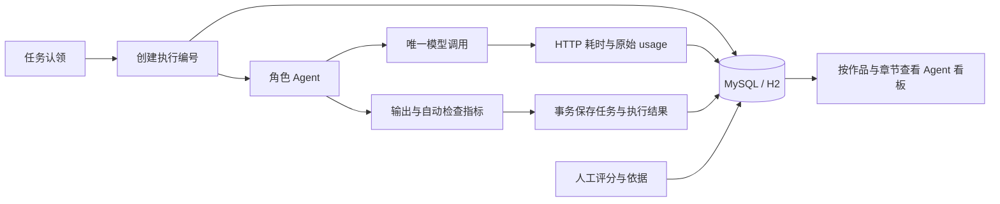

接口：`GET /api/observability`，参数为 `novelId`、`chapter`、`kind`、`status`、`page`（从0开始，每页30个任务）；`GET /api/observability/tasks/{id}` 提供任务详情；`POST /api/observability/tasks/{id}/feedback` 接收 `rating` 和 `note`。详情不包含模型请求正文，事件页面显示最近500条；全部事件继续保留在数据库。

## 本地日志与选题进度

启动后，IDEA Console 和本地文件 `data/logs/novel-agent.log` 同时显示中文过程说明：作品名称、章节、Agent 职责、任务编号前八位、模型、等待秒数和 token 用量。阶段大纲使用阶段任务标签；选题任务通过任务编号区分。控制台仅保留时间、级别与说明，文件同时保留日期与日志来源。请求正文、API key 和请求头不进入这些事件日志。事务中的事件在提交后输出，数据库继续保存完整编号、原始事件及元数据，供看板查询。

执行期间每15秒说明当前阶段、任务执行时间和模型调用时间，统一使用秒。模型请求、收到 HTTP 响应、用量保存、业务结果保存分别输出明确说明；重复的调度和 AgentScope 内部生命周期事件使用 DEBUG 级别，失败使用 ERROR，限流等待使用 WARN。免费服务明确显示“本次免费”，付费服务显示预留费用上限及按配置单价估算的费用。当前采用完整响应模式，等待期间没有已完成的正文 token 统计；收到响应后显示用量，未报告的缓存用量显示“未报告”。

以下为格式示例：

```text
11:13:16 INFO  [《示例作品》 · 阶段大纲规划 · 任务69369648] 开始执行，正在准备所需资料
11:13:16 INFO  [《示例作品》 · 阶段大纲规划 · 任务69369648] 请求模型 local / gpt-5.6-luna，本次免费，等待完整回复
11:13:45 INFO  [《示例作品》 · 阶段大纲规划 · 任务69369648] 等待模型完整响应；任务已用 28.6 秒，模型调用已用 28.4 秒
11:14:17 INFO  [《示例作品》 · 阶段大纲规划 · 任务69369648] 阶段大纲已保存，等待人工审核
```

日志格式配置和 Java 代码在服务下次启动时生效。

日志文件使用 UTF-8，按10MB轮转，保留14天，总容量上限200MB；通过 `NOVEL_LOG_FILE` 可以修改输出位置。默认日志位于 Git 忽略的 `data/` 目录。PowerShell 持续查看：

```powershell
Get-Content -LiteralPath 'D:\java_learning\novel-agent\data\logs\novel-agent.log' -Tail 80 -Wait -Encoding UTF8
```

选题研究与讨论页面每5秒读取持久化进度，展示任务阶段、已执行时间、模型等待时间、最近事件和错误；状态未变化时继续更新时间，填写中的内容会保留。回复完成后可以点击“查看生成过程、耗时与费用”查看关联任务。时间显示采用北京时间。

`GET /api/observability/tasks/{id}/progress` 返回轻量进度信息和最近12条事件，不返回任务输入或模型输出；全部历史与原始输出继续通过任务详情查询。执行阶段根据已保存的任务、调用及事件计算。

## 代码入口

后端采用 MVC 分层。`NovelApplication` 位于根包，`controller` 处理 HTTP 路由与响应，`dto` 定义请求和参数校验，`service` 承担业务流程，`repository` 封装 MyBatis 访问与事务，`repository/mapper` 保存 Mapper 接口。模型接入位于 `integration/model`，持久化任务调度位于 `engine`，框架配置位于 `config`，JSON 工具位于 `support`。Controller 通过 service 访问业务数据。

| 文件 | 职责 |
| --- | --- |
| [NovelController.java](src/main/java/dev/novel/controller/NovelController.java) | 小说、章节与审核接口 |
| [ResearchController.java](src/main/java/dev/novel/controller/ResearchController.java) | 选题和报告交流接口 |
| [SystemController.java](src/main/java/dev/novel/controller/SystemController.java) | 状态、模型服务与费用接口 |
| [ApiRequests.java](src/main/java/dev/novel/dto/ApiRequests.java) | 请求 DTO 和参数校验 |
| [Store.java](src/main/java/dev/novel/repository/Store.java) | 数据库查询、写入及事务访问 |
| [WorkspaceService.java](src/main/java/dev/novel/service/WorkspaceService.java) | 工作台查询、发布标记及正文导出 |
| [ResearchService.java](src/main/java/dev/novel/service/ResearchService.java) | 个人想法、资料采集、选题讨论和交流记录 |
| [WorkflowService.java](src/main/java/dev/novel/service/WorkflowService.java) | 完成步骤、汇总检查、安排下一步及统一提交 |
| [TaskEngine.java](src/main/java/dev/novel/engine/TaskEngine.java) | 调度、工作线程、失败处理和启动恢复 |
| [AgentService.java](src/main/java/dev/novel/service/AgentService.java) | 独立 Agent 注册、分发、结果恢复和分析查询 |
| [NovelAgent.java](src/main/java/dev/novel/agent/NovelAgent.java) | 角色任务类型、职责与上下文清单 |
| [AgentContextService.java](src/main/java/dev/novel/agent/AgentContextService.java) | 按角色提供资料、检查记忆与正文版本 |
| [AgentOutputs.java](src/main/java/dev/novel/dto/AgentOutputs.java) | Agent 输出 DTO 与 Bean Validation 约束 |
| [AgentOutputReader.java](src/main/java/dev/novel/agent/validation/AgentOutputReader.java) | Jackson 类型映射与嵌套字段验证 |
| [TaskExecutionConfiguration.java](src/main/java/dev/novel/config/TaskExecutionConfiguration.java) | Spring 任务线程池与关闭流程 |
| [MemoryService.java](src/main/java/dev/novel/service/MemoryService.java) | 版本化事实、上下文组装及记忆增量校验 |
| [StoryGraph.java](src/main/java/dev/novel/integration/graph/StoryGraph.java) | Neo4j/TinkerGraph 查询选择、限定深度与历史版本读取 |
| [MemoryProjectionCache.java](src/main/java/dev/novel/integration/cache/MemoryProjectionCache.java) | 用户和版本范围内的 Redis 查询缓存 |
| [ProjectService.java](src/main/java/dev/novel/service/ProjectService.java) | 人工审批、暂停恢复和历史修改 |
| [ModelClient.java](src/main/java/dev/novel/integration/model/ModelClient.java) | 模型配置选择、响应复用、请求和结算 |
| [AgentScopeExecutor.java](src/main/java/dev/novel/integration/model/AgentScopeExecutor.java) | ReActAgent、OpenAIChatModel、MiddlewareBase 与请求费用扩展 |
| [ModelRateLimiter.java](src/main/java/dev/novel/integration/model/ModelRateLimiter.java) | Redisson 模型调用限流 |
| [TaskDispatchMapper.java](src/main/java/dev/novel/repository/mapper/TaskDispatchMapper.java) | MyBatis 任务候选查询与条件认领 |
| [ModelCallMapper.java](src/main/java/dev/novel/repository/mapper/ModelCallMapper.java) | MyBatis 模型响应、费用与调用状态写入 |
| [MemoryMapper.java](src/main/java/dev/novel/repository/mapper/MemoryMapper.java) | MyBatis 记忆快照、历史基准及增量写入 |
| [MyBatisConfiguration.java](src/main/java/dev/novel/config/MyBatisConfiguration.java) | 字段映射、CLOB 类型与本地缓存配置 |
| [RedisConfiguration.java](src/main/java/dev/novel/config/RedisConfiguration.java) | Redisson 连接配置与生命周期 |
| [ModelCatalog.java](src/main/java/dev/novel/integration/model/ModelCatalog.java) | 服务配置、模型列表和小说模型选择 |
| [BudgetService.java](src/main/java/dev/novel/service/BudgetService.java) | 并发费用预留、速率检查及费用核对 |
| [SkillService.java](src/main/java/dev/novel/service/SkillService.java) | 固定技能加载、角色参考资料选择和指纹验证 |
| [ChapterQualityService.java](src/main/java/dev/novel/service/ChapterQualityService.java) | 正文统计、字数和对话占比检查、质量历史 |
| [TruthDocumentService.java](src/main/java/dev/novel/service/TruthDocumentService.java) | 当前状态文档、交接资料和 ZIP 导出 |
| [schema.sql](src/main/resources/schema.sql) | 作品、任务、章节、记忆及调用记录表 |

## 验证范围

1.7.2 的59项非模型检查通过，Java 17 打包通过。其中13项在独立 MySQL 测试数据库执行，覆盖并发预算、版本关系、历史修改、草稿更新、调度时间、执行记录和人工评价；2项连接独立 Redis 验证共享限流以及记忆缓存的作品、版本和查询深度隔离。业务验证使用专用测试记录，模型生成另行验证。`ReviewEvidenceIntegrationTest` 覆盖连续原文引用与拼接引用的处理。

本机 Edge 通过 Playwright 在独立测试服务切换全部9个作品页面，核对渲染内容与浏览器错误；1440×1000及390×844尺寸检查通过，手机尺寸没有整页横向溢出。Browser plugin not available，因此使用本机 Playwright；未使用截图，不评价视觉设计。Neo4j 的 Bolt 登录、独立节点写入、读取及删除通过，小说业务仍未接入 Neo4j。原有8096端口服务及其作品数据保持原状。

`MySqlIntegrationTest` 和 `MarkdownMemoryMySqlTest` 默认关闭，设置 `NOVEL_MYSQL_TEST=true` 后读取本地 MySQL 配置，共用专用库 `novel_agent_test`。每个测试类通过 MySQL advisory lock 独占该库，使用 Flyway clean 清理该库，再由应用迁移初始化；此名称仅用于测试。`MemoryCacheIntegrationTest` 受 `NOVEL_REDIS_TEST=true` 控制，Redis 测试可通过 `NOVEL_REDIS_ADDRESS` 指向独立端口，使用独立 key 范围。完整历史数据迁移尚未执行。

2026-10-25 恢复运行验证：`ContextBudgetIntegrationTest`、`MarkdownMemoryIntegrationTest`、`ReviewEvidenceIntegrationTest`、`AgentRuntimeIntegrationTest` 覆盖上下文预算、记忆发布、原文证据、工具权限、综合审核及工具空间耗尽后继续执行。正文审核通过 `planConflict` 标明批准计划内部或与世界规则之间的冲突，进入已有计划审批流程；普通正文问题继续生成修改任务。真实后端使用本地 `gpt-6-luna`、`high` 执行第10章修改与综合审核；完整章节提交与长期连载效果需结合实际结果判断。

测试记忆、AgentState 和日志统一放在忽略目录 `.work/tests/`；JUnit 关闭并行执行，测试类持有文件锁，结束后清理本类新增的记忆及会话文件。UI 验证资料通过 `novel.tests.keep-files=true` 保留，`mvnw.cmd clean` 清理整个 `.work/tests/`。正式 AgentState 目录通过 `NOVEL_AGENT_STATE_DIRECTORY` 配置，默认 `data/agent-sessions`。

启动脚本检查服务端口后，将运行包复制到固定的 `.work/runtime/novel-agent.jar`。候选记忆保存在任务结果和模型响应中，发布时才生成不可变记忆文件；历史版本继续由数据库清单引用。构建上下文时复用本次读取的记忆入口、文件清单、大纲与质量记录。

`LiveWorkflowTest` 受 `NOVEL_LOCAL_WORKFLOW_TEST=true` 控制，仅允许连接本机8317端口且计费方式必须为 `unmetered`。该验证使用实际 TaskEngine 调度、真实模型请求和独立文件数据库，允许自动流程停在阶段审核、重要变更审核或修改额度耗尽后的人工处理状态；接口检查通过与正文被接受分别记录。

2026-10-18 使用本地 `gpt-5.6-luna` 执行一次真实流程：大纲、正文、四轮并行检查、四次修改分析与三次正文修改共25次模型调用，输入351621 token、输出31222 token，记录费用0元。流程最终为 `AWAITING_HELP`，正文仍为草稿，记忆版本0；自动修改额度用完后交给人工处理的行为正确，本次正文验收未通过。没有执行记忆提取与记忆审核，不能据此宣称完整连载验证通过。关系记忆、事务与历史修改的验证范围来自专用数据库测试。

本次独立作品为 `e2593cad-c94d-49cb-98bb-1f631c329aef`，数据库位于 `.work/live-workflow-03549cd9-6e9f-4991-bc74-e526f2935e93.mv.db`；保留25条原始模型响应、25次执行记录、任务与事件。运行日志为 `.work/live-workflow.log`，自动化与打包记录为 `.work/regression-test.log`，真实流程检查记录为 `.work/live-workflow-test.log`。这些资料均被 Git 忽略，未包含进发布 JAR；本次没有迁移或修改已有作品的数据。

1.6.1 的6项相关数据库与 HTTP 检查通过；真实 DeepSeek 完成一次选题和一次讨论，验证轻量进度、模型调用阶段、用量、本地日志、回复记录入口及编辑内容保留。Playwright 使用本机 Edge，在1440×1000和390×844窗口验证交互及横向尺寸，未使用截图。两次配置估算费用合计0.083446元，资料保存在独立验证数据库；文学质量、Redis 与全部角色组合、长期连载仍需继续验证。

观测功能还使用真实 H2 文件验证重启保留、执行恢复、费用与检查统计去重、人工评价历史及接口参数。费用统计检查中的记账资料与真实模型调用分别记录；全局及作品看板、筛选、详情与人工评价交互已验证。

```powershell
$env:JAVA_HOME = 'C:\Program Files\Java\jdk-17'
.\mvnw.cmd -B -ntp package
```

自动验证使用真实 H2 数据库、TinkerGraph 和本地 HTTP 接口，覆盖并发费用预留、速率限制、关系历史查询、证据校验、事务完整性、人工审核、历史修改、恢复及失败隔离，同时验证固定技能、正文统计、质量历史、交接资料和 ZIP 导出。具体版本的验证结果记录在 [CHANGELOG.md](CHANGELOG.md)。

`RedisIntegrationTest` 使用真实 Redis 和两个独立 Redisson 客户端，检查并发共享额度与重新连接后的额度保留。默认不执行，设置 `NOVEL_REDIS_TEST=true` 后可以运行。真实模型检查增加框架版本和 Middleware 事件记录核对。

`LiveModelTest` 默认不执行。配置真实模型并设置 `NOVEL_LIVE_TEST=true` 后，可以运行真实模型验证；计费服务按配置单价计算费用，免费服务记录零费用。

```powershell
$env:NOVEL_LIVE_TEST = 'true'
.\mvnw.cmd -B -ntp '-Dspring.profiles.active=local' '-Dtest=LiveModelTest' test
```

真实模型验证覆盖大纲、正文、四个并行检查及调用中的技能记录；正文检查通过时继续验证记忆提取与记忆检查。小说质量、长期连载中的检索准确率、动态榜单的可读取范围及实际收益需要结合真实运行评价。
