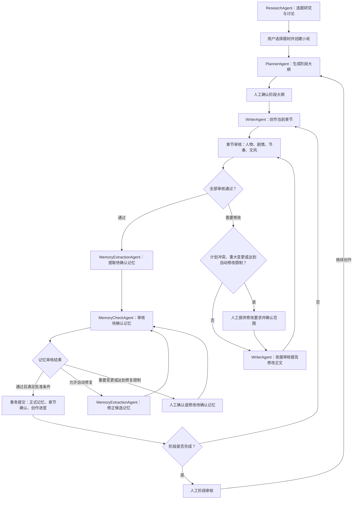
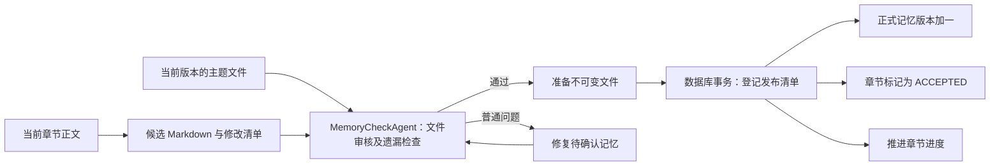
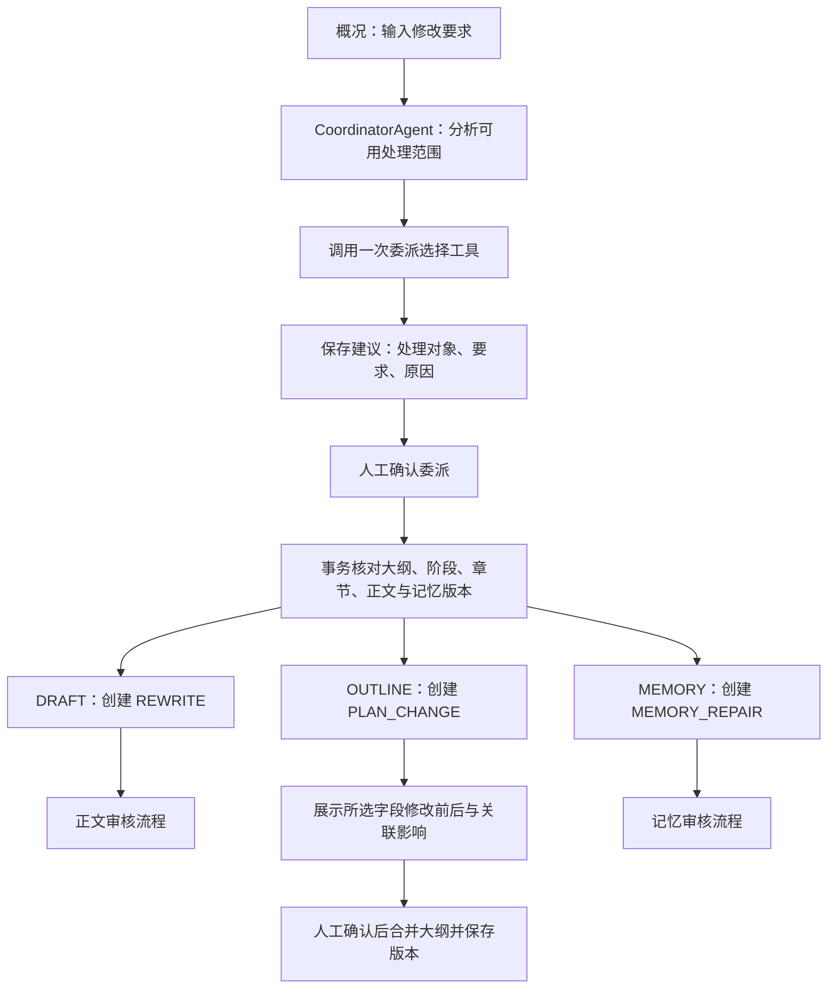
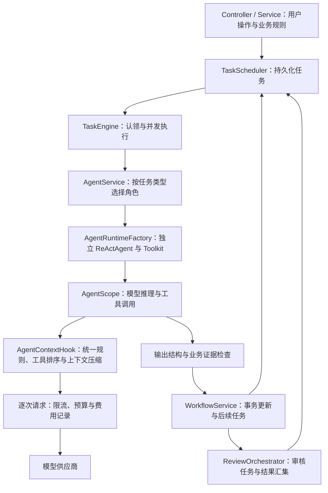

# 小说 Agent 流程与职责

依据版本：1.19.3；核查日期：2026-10-25。

## 用户身份与隔离

用户登录后只能访问自己的作品、选题、任务与费用。后台任务保存所属用户，执行时恢复用户范围并在结束时清理；Agent 工具核对任务与作品归属。记忆缓存按用户、作品和版本区分。已有数据归入本地 owner 账号，登录信息保存在 Git 忽略文件 `config/auth-local.json`。会话在服务重新启动后需要重新登录，任务与业务数据继续持久化保存。

## 逐章创作流程

选题研究可以使用个人想法及公开资料地址，也可以直接创建小说。阶段大纲生成后等待人工批准；当前阶段每章完成后自动开始下一章，阶段完成后等待人工审核，再进入下一阶段规划。

正文创作结果立即保存为草稿。审核通过后才进入记忆提取；正式记忆提交成功后，章节才成为已确认章节。当前流程没有自动发布到小说平台的操作。

## Agent 职责

| 角色 | 任务类型 | 主要职责与输出 |
| --- | --- | --- |
| ResearchAgent | `RESEARCH`、`RESEARCH_CHAT` | 生成选题方案，结合用户反馈继续讨论 |
| PlannerAgent | `PLAN` | 生成阶段目标、核心剧情节点及连续章节安排 |
| WriterAgent | `WRITE`、`REWRITE` | 创作或修改当前章节正文 |
| ChapterReviewAgent | `CHECK_CHAPTER` | 联合检查人物、剧情、节奏、文风 |
| MemoryExtractionAgent | `MEMORY`、`MEMORY_REPAIR` | 整理或修复 Markdown 主题文件、本章摘要与来源 |
| MemoryCheckAgent | `CHECK_MEMORY` | 逐项审核文件修改，检查本章遗漏及跨文件一致性 |
| PlanChangeAgent | `PLAN_CHANGE` | 为选定大纲字段生成局部修改建议与影响分析 |
| CoordinatorAgent | `COORDINATE` | 分析用户修改要求，选择正文、大纲或记忆处理角色 |

表中共8个业务 Agent，启动时检查数量上限。`ChapterAuthorAgent` 和 `ReviewAgent` 提供共享行为；一个组件可以处理多个操作，每个任务创建独立执行实例和上下文。`GET /api/agents` 按组件提供目录，`kinds` 列出支持的操作。历史专项审核任务由综合审核组件接收，历史 `REFLECT` 由写作组件兼容处理。

## 章节审核与修改

默认 `NOVEL_REVIEW_MODE=combined`，一个 `ChapterReviewAgent` 检查人物、剧情、节奏和文风，分别输出维度结论与问题归属。审核绑定正文 revision 与记忆版本，`ReviewOrchestrator` 核对本轮结果后决定后续任务。已经创建的历史审核轮次保持原操作集合。

- 全部通过：进入记忆提取。
- 存在问题：业务流程直接使用审核报告生成正文修改要求。
- 普通修改：创建 `REWRITE`，完成后重新审核正文。
- 计划冲突：`planConflict=true` 且审核未通过时，保存审核依据并进入 `AWAITING_CHANGE`，等待完整计划审批，保留当前正文。
- 涉及重大变更：进入 `AWAITING_CHANGE`，等待人工确认。
- 正文自动修改达到三轮：进入 `AWAITING_HELP`，等待人工提供要求。

审核证据通过正文段落路径等信息定位，由程序校验引用来源；不符合证据规则的输出会使任务失败，并保留模型响应。

一章单组记忆且全部一次通过时包含4次主要调用：正文创作、综合审核、记忆整理、记忆审核。工具查询、正文修改、记忆分组、压缩和请求重试增加的调用单独记录，阶段规划按阶段执行。

## 记忆处理与人物关系

整理结果包含摘要与文件修改，文件按人物、世界规则、伏笔、支线、阶段和章节组织。稳定标识、别名与正文来源写入 Markdown；推测、人物认知、计划和已确认事实分别表达。

记忆审核按共享证据和输入大小组织候选文件。只有一组时使用 `ALL`，同时检查文件修改、全文遗漏及跨文件一致性；多组时依次执行 `FILES`，最后执行 `COVERAGE`。所有阶段绑定同一份候选指纹，任何修正都返回完整候选集合并重新审核。

记忆审核发现表述问题时，自动修复对象是待确认记忆，正文与大纲保持当前版本。最多自动修复三轮；重要变更或超过限制后，在概况页面提供人工处理入口，可以提交修改要求，也可以直接编辑记忆后重新审核。

正式提交前再次检查章节编号、正文 revision、memoryVersion、候选指纹和旧文件指纹。文件在事务外准备，发布清单、章节确认、进度及下一任务在同一数据库事务中完成。

写作上下文包含短入口、当前状态、交接与本章明确相关的主题文件。Agent 通过授权的文件目录、关键词搜索、范围读取及正文来源工具补充资料，查询范围绑定当前用户、作品与任务版本。

`lookup_memory` 按稳定标识或名称返回真实路径与 `FOUND`、`NOT_FOUND`、`AMBIGUOUS` 状态。正式读取标记 `scope=published`，候选读取标记 `scope=candidate`；未命中允许继续查询。历史来源和程序生成文件通过 `editPolicy` 标记只读，版本冲突、权限错误及正式文件损坏明确失败。

人物关系与知情范围保存在 Markdown，关系文件使用 `story-relations` JSON 代码围栏提供明确的图记录，人物文件通过链接引用。启用 Neo4j 后，首次查询一个已发布版本时建立独立图投影，后续在数据库中执行限定深度查询；用户、作品和版本分别隔离，关系解除与历史修改通过新版本保留。旧关系附录继续支持读取。关闭 Neo4j 时使用进程内 TinkerGraph。

## 用户修改要求与协调委派

协调入口在人工审核或暂停状态使用，并要求当前相关任务完成。CoordinatorAgent 按当前状态选择一个可执行对象，通过 `delegate_draft`、`delegate_outline` 或 `delegate_memory` 表达选择。

委派工具生成建议；人工确认后，后端创建独立的持久化任务。重复确认或版本变化会被拒绝。CoordinatorAgent 只在用户提交修改要求时参与，正常逐章创作由业务工作流推进。

局部大纲修改支持阶段目标、核心剧情节点及章节目标、人物、伏笔字段。页面展示修改前后与影响范围，确认后只合并所选字段。涉及核心剧情或已完成章节时，需要明确确认对应范围。已经完成的正文与记忆调整通过历史修改流程处理。

## 框架与后端编排

AgentScope Java 2.0.4 负责推理、Toolkit、生命周期和 AgentState 存储；上下文压缩使用 Harness 的 `ConversationCompactor`，临时 HTTP 错误的退避重试使用 Resilience4j。各组件声明职责和授权工具，`ModelClient` 提供可复用规则前缀与任务上下文。

`WorkflowService` 决定正文、审核、记忆和下一章之间的状态变化。`ReviewOrchestrator` 管理审核操作集合与结果汇集。协调委派经人工确认后创建后台任务；任务通过数据库认领执行，业务状态在事务中推进。

资料读取默认允许8轮推理和一次最终输出，协调操作默认2轮；可配置1至24轮。另预留4次请求供压缩与 HTTP 重试共用，全部请求共用限流、费用和记录。压缩保留原始任务资料，使用框架汇总工具历史；压缩次数受总请求预算约束。无工具操作的一次主要调用也受同一记录与重试规则约束。

工具单次默认24000字节，每次请求可使用的工具结果空间最多60000字节，随当前请求剩余空间重新计算。`read_memory_batch` 返回继续位置、未读路径及缺失路径。初始资料按稳定标识、名称和 YAML 别名选择主题，容量不足时延后加载完整主题并更新 `_loadedMemory`；工具空间不足返回 `BUDGET_EXHAUSTED`。

## 上下文与规则复用

每组记忆审核同时提供完整候选目录与当前组序号。跨组核对读取对应候选文件，正式文件保持发布前版本；全部分组及完整遗漏检查通过后才发布记忆。

技能来源原文及对应 references 保留并校验，`runtime-rules.md` 提供应用运行规则。角色族共享不可变技能快照，系统规则通过 `onSystemPrompt` hook 注入，章节、正文及候选等动态资料放在后续消息。JSON 对象字段与工具顺序固定，`PROMPT_PREFIX_READY` 记录前缀指纹。

模型调用前，hook 按请求估算字节与 token 数判断是否需要压缩。达到120000字节保护上限的75%或输入 token 预算的80%时，框架总结较早执行历史并保留近期完整工具调用组。系统规则保留，摘要包含目标、输出字段、已核对事实、来源和下一操作；证据引用仍需要原文。每个任务最多压缩两次，压缩请求也保存用量。无法压缩或压缩后仍超过容量时明确报告。

token 数采用框架估算；模型容量通过 `NOVEL_MODEL_CONTEXT_TOKENS` 或 `novel.context-models.<model>.tokens` 配置，输出额度与包装空间另行预留。实际缓存命中取自供应商返回值，日志显示缓存 token 和命中率；可选启用 `NOVEL_PROMPT_CACHE_KEY_ENABLED`，前缀复用本身不代表缓存命中。

免费服务返回 HTTP 408、429、502、503、504 时，Resilience4j 最多追加两次请求，等待间隔为1秒、2秒。付费请求结果不确定时保留费用核对流程。权限、版本和数据损坏错误直接报告。

## 持久化、恢复与观测

| 数据 | 保存与使用方式 |
| --- | --- |
| 任务输入、结果、错误与状态 | 数据库保存，用于调度、执行详情与恢复 |
| 正文、历史版本与大纲修改 | 数据库保存；正式状态通过事务更新 |
| 正式记忆与历史文件 | 不可变 Markdown 文件；数据库登记发布清单、指纹和当前版本 |
| Agent 执行事件与耗时 | 数据库保存，前端执行记录与 Agent 看板查询 |
| 单次 HTTP 请求与用量 | `model_call_turns` 保存请求、响应、token、缓存用量、时间及估算费用 |
| 任务级模型调用 | `model_calls` 保存最终响应检查点与合计用量、费用 |
| Agent 工作状态 | 框架保存到 `data/agent-sessions`，按用户与任务隔离 |
| 共享限流与记忆缓存 | Redisson / Redis；数据库保存正式业务状态 |

完整的最终 Agent 输出可以作为检查点复用。中断调用的费用无法确认时，任务需要人工核对费用后才能重新执行。失败任务可以重新选择模型，原执行记录与费用继续保留。

MySQL 与已有 H2 数据均有适配；已有作品数据是否使用 MySQL，取决于启动配置与迁移状态。现有作品数据尚未完成 MySQL 迁移。API key、运行数据库与日志保存在 Git 忽略范围内。

前端通过状态快照和事件编号自动同步变化。执行详情可以查看输入、输出、错误与逐次调用信息；Agent 看板提供角色权限、耗时、token 与费用记录。费用根据供应商配置和返回用量估算，供应商账单用于最终核对。

1.19.2 已通过前端构建、后端编译与打包；上下文预算、记忆发布、审核证据、工具执行和计划冲突相关检查48项通过、2项跳过。真实章节流程继续核查；工作状态文件不代表结果不确定的外部调用可以直接重放。

## 人工处理位置

| 触发条件 | 用户操作 |
| --- | --- |
| 阶段大纲生成完成 | 查看并批准当前阶段大纲 |
| 阶段内全部章节完成 | 审核阶段结果，决定继续创作 |
| 正文重大变更 | 确认修改范围并提供要求 |
| 正文自动修改达到限制 | 查看审核意见并提交修改要求 |
| 重要记忆变更或修复达到限制 | 确认、编辑记忆或提交记忆修改要求 |
| 协调建议生成完成 | 确认交给所选 Agent |
| 局部大纲修改建议生成完成 | 查看变更与影响后确认合并 |
| 预算暂停或调用费用待核对 | 调整额度或核对费用后继续 |

## 代码入口

- `src/main/java/dev/novel/service/WorkflowService.java`：主流程状态变化与记忆提交。
- `src/main/java/dev/novel/service/CoordinationService.java`：协调请求、人工确认与任务委派。
- `src/main/java/dev/novel/service/PlanChangeService.java`：局部大纲修改建议与确认。
- `src/main/java/dev/novel/agent/orchestration/ReviewOrchestrator.java`：审核模式、任务与结果汇集。
- `src/main/java/dev/novel/agent/runtime/AgentRuntimeFactory.java`：独立 Agent 与工具构建。
- `src/main/java/dev/novel/agent/runtime/StoryReadTools.java`：查询与委派工具。
- `src/main/java/dev/novel/integration/model/AgentContextHook.java`：规则注入、工具排序与上下文压缩。
- `src/main/java/dev/novel/engine/TaskEngine.java`：后台任务执行与恢复。
