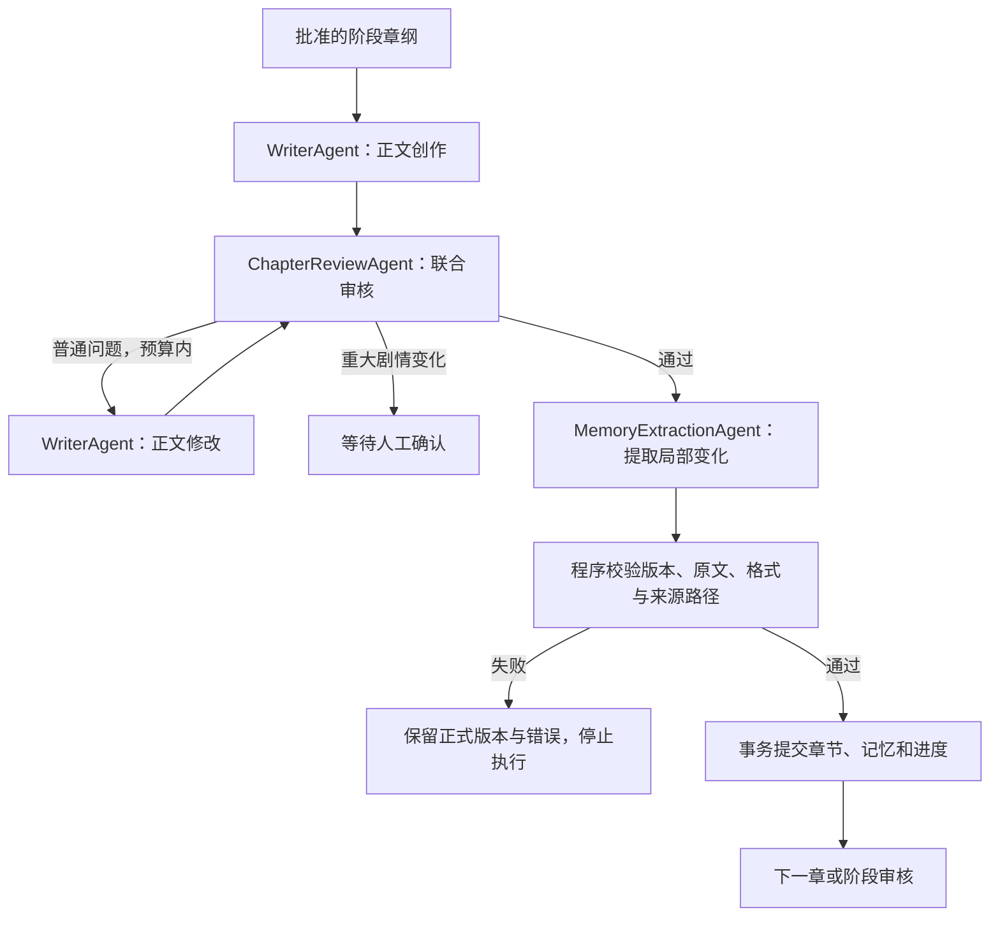

# 小说 Agent 流程与职责

版本：1.20.0；更新日期：2026-10-26。

## 每章流程

默认联合审核模式下，每章一次通过包含3次主要模型调用：正文、正文审核、记忆提取。读取工具、压缩、HTTP 重试与正文修改产生的请求分别记录。实际 token 与缓存命中以供应商用量为准，主要调用数量不能直接换算为 token 节省比例。

## 六个业务 Agent

| 组件 | 操作与职责 |
| --- | --- |
| ResearchAgent | 选题研究、讨论与创意资料 |
| PlannerAgent | 阶段规划、局部大纲修改建议；正式应用需要人工确认 |
| WriterAgent | 正文创作与修改；兼容已有修改分析操作 |
| ChapterReviewAgent | 人物、剧情、节奏和文风联合检查；兼容历史专项检查 |
| MemoryExtractionAgent | 提取记忆局部变化、按人工要求修正；兼容候选的本地校验 |
| CoordinatorAgent | 用户主动提交修改要求时分析处理范围，确认后委派 |

组件不保存可变作品会话，模型执行按任务创建。数据库保存任务、正文修订、正式记忆版本和调用记录。每章的正常推进由 WorkflowService 管理。

## 记忆输入与输出

提取输入包含本章正文、当前状态、交接和目录，需要修改的人物或伏笔主题按需读取。修正输入只增加人工要求、历史问题和上次错误，不重复提供整批候选全文。

已有主题输出 `edits[{oldText,newText}]`，同时提供真实路径、文件指纹、修改说明和正文来源路径。程序基于同一份原文计算所有修改位置，要求唯一匹配且互不重叠，逆序应用后保留其余内容。普通主题不能整篇替换，单处原文最多2048字节。

新主题使用完整 Markdown `content`、空 `edits`、独立稳定标识和允许的路径。历史来源保持只读。每章最多12个文件、每文件12处修改，总模型输出最多32000字节。当前状态和交接各最多6000字节。

MemoryPatchService 应用局部修改，MemoryFileService 校验 Markdown、文件类型、稳定标识、关系唯一性、链接、正文来源路径和版本。程序能够验证来源存在，语义正确性仍需要内容评价。重大剧情变更通过正文和大纲的人工审批流程处理。

正式文件保持不可变，准备完成后，在同一数据库事务中登记文件清单、正式章节、记忆版本及下一任务。准备或提交失败不会改变正式版本。正文已经通过检查时，记忆处理失败保留当前正文。

## 任务兼容与暂停

已有 CHECK_MEMORY 任务和人工编辑候选通过本地校验提交，不调用审核模型。历史任务、费用和错误保留，已经存在的人工处理入口继续可用。记忆校验失败明确报告，不自动创建修正循环。

阶段大纲、阶段完成、重大剧情变更和重要历史修改继续等待人工确认。任务暂停时，已完成结果保存为 READY；恢复后仍核对正文修订及记忆版本。费用不确定的外部调用继续要求核对后才能重新执行。

## 上下文、持久化与观测

AgentScope Java 提供独立执行实例、Toolkit 和工作状态；Harness ConversationCompactor 总结工具历史并保留原始任务。规则使用稳定系统前缀和 hook 注入，动态正文与资料放在任务输入。压缩、工具读取、模型重试共用请求与费用预算。

MyBatis 管理业务数据库访问，Redis / Redisson 提供缓存和限流，Neo4j 提供关系查询，Markdown 保存正式记忆。执行详情记录请求、响应、token、缓存命中、耗时及费用。

## 代码入口

- `src/main/java/dev/novel/agent/MemoryExtractionAgent.java`：提取提示词及候选兼容。
- `src/main/java/dev/novel/service/MemoryPatchService.java`：局部修改与原文保护。
- `src/main/java/dev/novel/service/MemoryFileService.java`：文件校验、不可变版本与关系投影。
- `src/main/java/dev/novel/service/WorkflowService.java`：章节流程与事务提交。
- `src/main/java/dev/novel/agent/PlannerAgent.java`：规划与大纲建议。
- `src/main/java/dev/novel/agent/orchestration/ReviewOrchestrator.java`：正文审核汇集。
- `src/main/java/dev/novel/engine/TaskEngine.java`：任务执行、恢复与失败记录。
