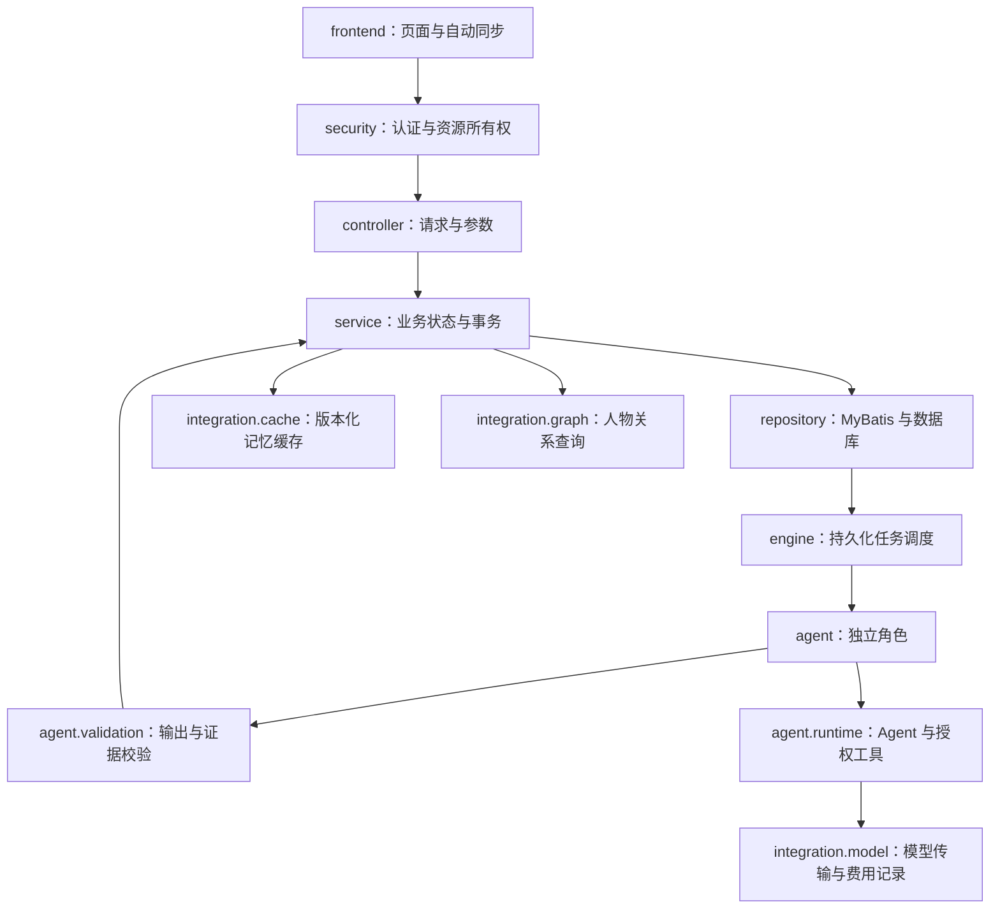

# 项目结构与代码导航

核查版本：1.12.1；日期：2026-10-22。

## 执行关系

图中表示职责交互。Controller 通过 Service 操作业务数据；HTTP 认证由 Spring Security 过滤链执行，资源所有权由 MVC 拦截器检查。

## 后端目录

| 目录，均相对于 `src/main/java/dev/novel` | 职责 | 阅读入口 |
| --- | --- | --- |
| `controller` | HTTP 请求、输入校验与错误响应 | `NovelController`、`AuthController` |
| `dto` | 请求字段及 Agent 输出类型 | `ApiRequests`、`AgentOutputs` |
| `security` | 登录安全配置、资源权限及线程用户范围 | `SecurityConfiguration`、`OwnershipInterceptor`、`UserScope` |
| `service` | 作品、选题、审核、记忆、费用及审批业务 | `ProjectService`、`WorkflowService`、`MemoryService` |
| `engine` | 认领任务、线程执行、恢复及错误处理 | `TaskEngine` |
| `agent` | 各创作角色、共享写作与审核行为、上下文组织 | `NovelAgent`、`PlannerAgent`、`ChapterAuthorAgent`、`ReviewAgent` |
| `agent/orchestration` | 审核角色集合、模式及结果汇集 | `ReviewOrchestrator`、`AgentRoles` |
| `agent/runtime` | 按任务构建 Agent、授权工具及受限委派 | `AgentRuntimeFactory`、`StoryReadTools` |
| `agent/validation` | JSON 类型、Bean Validation、大纲及引用证据检查 | `AgentOutputReader`、`PlanValidator`、`ReviewValidator` |
| `integration/model` | 供应商选择、HTTP 传输、逐次费用及限流 | `ModelClient`、`AgentCallAccounting`、`AgentScopeExecutor` |
| `integration/cache` | Redis 记忆快照与关系查询缓存 | `MemoryProjectionCache` |
| `integration/graph` | 从记忆快照构建 TinkerGraph 并查询人物关系 | `StoryGraph` |
| `integration/storage` | 当前数据库类型及描述 | `DatabaseStorage` |
| `repository/mapper`、`repository/model` | 类型化 MyBatis 接口与持久化数据 | `TaskDispatchMapper`、`ModelCallMapper`、`MemoryMapper` |
| `repository` | 命名 SQL 调用、事务入口、事件及任务创建 | `Store` |
| `config` | MyBatis、Redis 与任务线程配置 | `MyBatisConfiguration`、`TaskExecutionConfiguration` |
| `support` | JSON、原文证据匹配与日志格式 | `Json`、`EvidenceMatcher` |
| `tools` | 需要主动运行的维护程序 | `MigrateH2ToMySql` |

`src/main/resources/mappers` 保存 SQL；`schema.sql` 用于 H2 初始化与幂等升级；`db/migration/mysql` 保存 MySQL Flyway 迁移。`skills/fanqie-novel-skill` 是固定版本的上游技能资料，应用适配规则在 `SkillService` 中维护。

`StoryGraph` 只返回普通数据，查询结束后关闭本次图实例。正式关系与证据由数据库中的版本化记忆保存，Redis 保存可重新生成的查询结果。

## 前端与运行文件

| 位置 | 用途 |
| --- | --- |
| `frontend/src/main.tsx`、`AuthGate.tsx`、`App.tsx` | 登录边界、查询缓存、路由与工作区外壳 |
| `frontend/src/pages` | 选题、作品、费用及执行看板页面 |
| `frontend/src/components` | 模型选择、任务详情、局部修改等业务组件 |
| `frontend/src/api.ts` | API 请求、CSRF、查询同步及用户草稿 |
| `.run` | IDEA 前后端运行配置 |
| `config` | 本地凭据与部署配置；敏感文件由 Git 忽略 |
| `data` | 实际运行数据与日志 |
| `.work` | 独立验证数据库、日志与临时验证程序，由 Git 忽略 |
| 根目录 `start*.ps1` | 应用与本机依赖启动入口 |
| `migrate-mysql.ps1` | 编译后调用迁移主类，核对并迁移全部业务表 |

## 验证入口

| 目标 | 测试 |
| --- | --- |
| 版本、预算及并发事务 | `DomainIntegrationTest` |
| Agent 运行实例与工具范围 | `AgentRuntimeIntegrationTest` |
| 记忆证据、审核与自动修复 | `MemoryEvidenceIntegrationTest`、`MemoryRepairIntegrationTest` |
| 正文引用证据 | `ReviewEvidenceIntegrationTest` |
| 中断执行与持久化恢复 | `ObservationIntegrationTest` |
| 双账号权限与接口隔离 | `UserIsolationIntegrationTest` |
| 局部大纲及人工确认 | `PlanChangeIntegrationTest` |
| 迁移完整性、非空目标拒绝及失败撤销 | `DatabaseMigrationTest` |
| 真实 MySQL 与 Redis | `MySqlIntegrationTest`、`RedisIntegrationTest`、`MemoryCacheIntegrationTest` |
| 真实供应商模型 | `Live*Test`，按对应环境变量显式启用 |

本地学习路线保存在 `C:/Users/cc/Documents/Obsidian Vault/小说agent/学习路线与代码阅读指南.md`，流程图见 [多 Agent 流程](multi-agent-workflow.md)。
