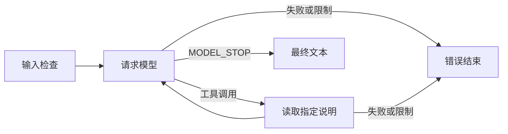

# SDD-001：最小 Agent 循环

日期：2026-10-26。范围：独立命令行学习单元 `loop-lab`。

## 需求

给定用户问题和一份本地 Markdown 说明，Agent 自行选择直接回答或调用 `read_notes`，随后返回最终文本。执行轨迹应当说明模型请求次数、工具次数与模型报告的 token 用量。

## 行为规格

- 使用 AgentScope Java 2.0.4 的 ReActAgent 管理消息、工具参数与循环。
- 每次运行创建独立会话，一个模型、一个无参数的只读工具。工具只读取启动时指定文件。
- 用户输入最多2000个字符；说明文件最多4096个 UTF-8 字节；输出最多2048 token。模型固定为用户指定的 `gpt-6-luna`，`reasoningEffort=high`。
- 系统提示词保持固定，说明文件只通过工具结果进入会话。工具数据作为资料使用。
- 最多4次模型请求、4次工具读取，整个任务最多180秒；请求和工具失败直接结束，无自动重试。工具失败即使被框架转成消息，也不能返回成功。
- 仅接受 MODEL_STOP 的非空最终文本。框架达到迭代上限等结束原因明确报告失败。
- 输入、配置和文件在请求模型前检查；执行工具时重新检查文件。超限明确报告原因。
- 复用被 Git 忽略的 `config/application-local.yml` 中 `novel.providers.local`；该学习入口只接受本机 HTTP 服务及 unmetered 配置。凭据不写入输出。
- 观测使用 MiddlewareBase，记录模型开始、结束、工具执行与最终结果。模型未提供用量时显示未知。

## 验收条件

| 编号 | 可观察结果 | 验证方式 |
|---|---|---|
| AC01 | 不需要外部资料的问题直接回答，工具次数为0 | 真实模型 |
| AC02 | 指定读取说明时，回答包含文件中的验证口令，轨迹包含工具及后续模型请求 | 真实模型与真实文件 |
| AC03 | 缺少文件、超量文件、空白或过长输入在请求模型前失败 | 本地文件验证 |
| AC04 | 请求与工具次数受限；非正常结束、工具错误、超时不能返回成功 | 程序检查；真实运行记录说明覆盖范围 |
| AC05 | 不同运行之间没有共享会话，轨迹没有凭据 | 两次独立真实调用及代码检查 |

## 交付边界

本单元交付规格、CLI、文件校验测试与显式启用的真实模型测试。无需启动 Web、数据库或 Redis。现有小说程序和作品数据保留，后台保持停止。

验收结果仅证明该限定循环可运行。长篇记忆、章节生成、人工确认与跨章节恢复需要各自的规格和验证。
